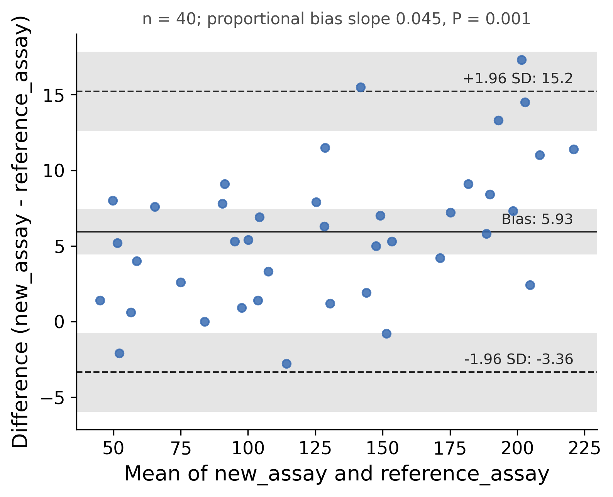

::: {.callout-important}
A manual command generated this report without an LLM model.
No separate human scientific review is part of this fixed recipe.
The report records the selected recipe and does not claim a new statistical method.
:::

## Figure

## Statistical results

| method_a | method_b | n | bias | bias_ci_low | bias_ci_high | sd_diff | loa_low | loa_high | loa_low_ci_low | loa_low_ci_high | loa_high_ci_low | loa_high_ci_high | prop_bias_slope | prop_bias_p | shapiro_p_diff |
| --- | --- | --- | --- | --- | --- | --- | --- | --- | --- | --- | --- | --- | --- | --- | --- |
| new_assay | reference_assay | 40 | 5.932500000000001 | 4.416927988565584 | 7.448072011434418 | 4.738894575201248 | -3.355562693926684 | 15.220562693926686 | -5.967442917757813 | -0.7436824700955547 | 12.608682470095557 | 17.832442917757817 | 0.04487823249742906 | 0.0010256286042581875 | 0.665288545023932 |

## Methods

Agreement between new_assay and reference_assay was assessed by the method of Bland and Altman (n = 40 pairs). The mean difference (new_assay - reference_assay) was 5.93 (95% CI 4.42 to 7.45) with a standard deviation of 4.74. The 95% limits of agreement were -3.36 (95% CI -5.97 to -0.744) and 15.2 (95% CI 12.6 to 17.8), computed as the mean difference plus or minus 1.96 standard deviations, with confidence intervals from the standard error of Bland and Altman (1999). A linear regression of the difference on the mean gave a slope of 0.045 (P = 0.001) as a test of proportional bias. The normality of the differences, which the limits assume, was checked with the Shapiro-Wilk test (P = 0.67). Computed in Python 3.10.12 with scipy 1.15.3 and drawn with matplotlib 3.10.9.

## Plot configuration

The complete plot configuration is in `plot_config.yaml`.

## Provenance

| field | value |
| --- | --- |
| repository | pubready |
| repository_version | 0.4.1 |
| git_commit | e8f923bef415cd1719ad862c56f1043770302fc8 |
| git_dirty | False |
| llm_provider | none |
| llm_model | none |
| agent_harness | manual |
| agent_harness_version | not_recorded |
| container_image | localhost/pubready:0.4.1 |
| container_digest | sha256:097c136b375dd40cd790ef1528d70d748ab67d06fc44e73c70de82b4a4782d17 |
| input | {"file": "input_new_assay_vs_reference_assay.csv", "md5": "a218e4c5dd5a5ae0131ca8fd388f991a", "sha256": "4a9865549eed01bcf632a92a15dd7c170ec624bef0d2e63d90ea3a3b72faec82"} |
| command | figkit plot --recipe bland_altman |
| analysis_options | {"engine": "python", "recipe": "bland_altman", "data": {"file": "method_agreement.csv", "x": "new_assay", "y": "reference_assay", "fill": null, "facet": null, "time": null, "event": null, "annotation": null, "covariates": null, "id": null, "group": null, "label": null, "positive": null, "se": null, "ci_low": null, "ci_high": null, "measure": null, "markers": null}, "test": {"method": "auto", "paired": false, "p_adjust": "none"}, "appearance": {"theme": "pubready_house", "palette": null, "x_label": null, "y_label": null, "title": null, "y_limits": [null, null], "show_points": true, "geom": "box", "bracket": {"show": true, "label": "p.signif"}, "scale": "row", "cluster": "both", "fc_cutoff": 1.0, "p_cutoff": 0.05, "top_n": 15, "pd_threshold": 20.0, "pr_threshold": -30.0}} |
| random_seeds | not_applicable |
| session_record | session_info.txt |
| created_utc | 2026-07-18T00:00:00Z |
| review_state | not_applicable |
| reviewer | none |
| quarto_version | 1.11.4 |

The report source reads only files in this bundle.
