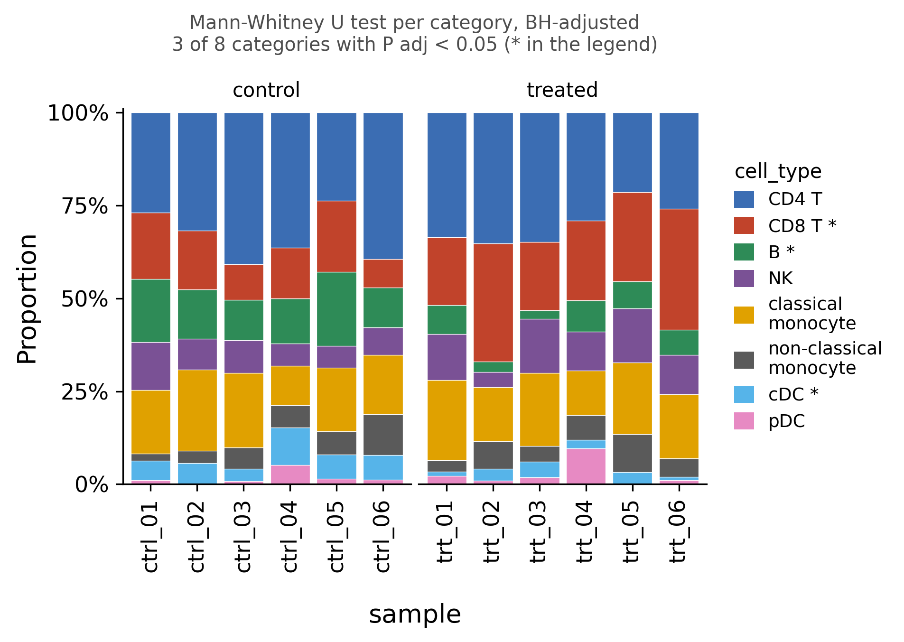

::: {.callout-important}
A manual command generated this report without an LLM model.
No separate human scientific review is part of this fixed recipe.
The report records the selected recipe and does not claim a new statistical method.
:::

## Figure

## Statistical results

| category | group | n_samples | mean_proportion | sd_proportion | median_proportion | test | statistic | p_value | p_adj | significant |
| --- | --- | --- | --- | --- | --- | --- | --- | --- | --- | --- |
| CD4 T | control | 6 | 0.3322081688703031 | 0.06879401013598019 | 0.3410890135454845 | Mann-Whitney U test | 24.0 | 0.3939393939393939 | 0.6303030303030304 | False |
| CD4 T | treated | 6 | 0.30044754843271465 | 0.055674881629673253 | 0.31327638066376373 | Mann-Whitney U test | 24.0 | 0.3939393939393939 | 0.6303030303030304 | False |
| CD8 T | control | 6 | 0.13912798306853338 | 0.04555859884273525 | 0.1471530513119026 | Mann-Whitney U test | 2.0 | 0.008658008658008658 | 0.023088023088023088 | True |
| CD8 T | treated | 6 | 0.24352601184411304 | 0.06369640424040718 | 0.22707785679711062 | Mann-Whitney U test | 2.0 | 0.008658008658008658 | 0.023088023088023088 | True |
| B | control | 6 | 0.13988208800540028 | 0.03699639781937181 | 0.12739571757927354 | Mann-Whitney U test | 36.0 | 0.0021645021645021645 | 0.017316017316017316 | True |
| B | treated | 6 | 0.059247940960604456 | 0.026648300876923523 | 0.07048543245262308 | Mann-Whitney U test | 36.0 | 0.0021645021645021645 | 0.017316017316017316 | True |
| NK | control | 6 | 0.0821522581508937 | 0.025997614310631603 | 0.07823949909924553 | Mann-Whitney U test | 9.0 | 0.17965367965367965 | 0.3593073593073593 | False |
| NK | treated | 6 | 0.11102285646015404 | 0.038772937615920475 | 0.11512819962015863 | Mann-Whitney U test | 9.0 | 0.17965367965367965 | 0.3593073593073593 | False |
| classical monocyte | control | 6 | 0.1711425270034731 | 0.03896829744263249 | 0.17098586952836267 | Mann-Whitney U test | 17.0 | 0.9372294372294373 | 0.9372294372294373 | False |
| classical monocyte | treated | 6 | 0.17346848756094913 | 0.03566170923406129 | 0.18222891351963938 | Mann-Whitney U test | 17.0 | 0.9372294372294373 | 0.9372294372294373 | False |
| non-classical monocyte | control | 6 | 0.057134807261174446 | 0.030943060365071367 | 0.05922540498123659 | Mann-Whitney U test | 16.0 | 0.8181818181818182 | 0.935064935064935 | False |
| non-classical monocyte | treated | 6 | 0.06115127699569043 | 0.025166039855392192 | 0.05867893299017091 | Mann-Whitney U test | 16.0 | 0.8181818181818182 | 0.935064935064935 | False |
| cDC | control | 6 | 0.06188149876996718 | 0.022240368631155364 | 0.06051464144464052 | Mann-Whitney U test | 35.0 | 0.004329004329004329 | 0.017316017316017316 | True |
| cDC | treated | 6 | 0.024747328519206167 | 0.012781803900642992 | 0.027171110481590197 | Mann-Whitney U test | 35.0 | 0.004329004329004329 | 0.017316017316017316 | True |
| pDC | control | 6 | 0.01647066887025486 | 0.018061226918523358 | 0.011667637917637919 | Mann-Whitney U test | 15.0 | 0.6991341991341992 | 0.9321789321789322 | False |
| pDC | treated | 6 | 0.02638854922656801 | 0.034819293778032175 | 0.014292966837378792 | Mann-Whitney U test | 15.0 | 0.6991341991341992 | 0.9321789321789322 | False |

## Methods

The counts of 8 categories of cell_type were summed within each of 12 samples (sample) and converted to proportions of the sample total. The samples fall into 2 groups (control: n = 6, treated: n = 6). For each category, the per-sample proportions were compared between the groups with the Mann-Whitney U test (two-sided, with the exact null distribution when there are fewer than 50 samples per group and no ties), and the P values were adjusted across the 8 categories with the Benjamini-Hochberg method; 3 categories had an adjusted P below 0.05. Proportions are compositional: they sum to one within each sample, so a rise in one category forces the others down and the per-category tests are not independent. The tests are therefore exploratory; a compositional method, for example a log-ratio transform, is needed for a confirmatory claim. Computed in Python 3.10.12 with scipy 1.15.3 and drawn with matplotlib 3.10.9.

## Plot configuration

The complete plot configuration is in `plot_config.yaml`.

## Provenance

| field | value |
| --- | --- |
| repository | pubready |
| repository_version | 1.0.0 |
| git_commit | 31d6bbe65e2043a4e8204e63902cf8f8a135acf6 |
| git_dirty | False |
| llm_provider | none |
| llm_model | none |
| agent_harness | manual |
| agent_harness_version | not_recorded |
| container_image | localhost/pubready:1.0.0 |
| container_digest | sha256:21946b0ae6b172f82e028cd57ac788e4b5b7161123799eebaf0ccc68dc590410 |
| input | {"file": "input_cell_type.csv", "md5": "4a74ef936bfc21d4bf2ccebb6e699014", "sha256": "329d74c430d92f2d03a0ec9b91979eaa4ead49770e328224a89d2665269c7910"} |
| command | figkit plot --recipe composition |
| analysis_options | {"engine": "python", "recipe": "composition", "data": {"file": "composition.csv", "x": "cell_type", "y": "n_cells", "fill": null, "facet": null, "time": null, "event": null, "annotation": null, "covariates": null, "id": "sample", "group": "condition", "label": null, "positive": null, "se": null, "ci_low": null, "ci_high": null, "measure": null, "ref": null, "cause": null, "levels": null, "markers": null}, "test": {"method": "auto", "paired": false, "p_adjust": "none"}, "appearance": {"theme": "pubready_house", "palette": null, "x_label": null, "y_label": null, "title": null, "y_limits": [null, null], "show_points": true, "geom": "box", "bracket": {"show": true, "label": "p.signif"}, "scale": "row", "cluster": "both", "fc_cutoff": 1.0, "p_cutoff": 0.05, "top_n": 15, "pd_threshold": 20.0, "pr_threshold": -30.0}} |
| random_seeds | not_applicable |
| session_record | session_info.txt |
| created_utc | 2026-07-18T00:00:00Z |
| review_state | not_applicable |
| reviewer | none |
| quarto_version | 1.11.4 |

The report source reads only files in this bundle.
