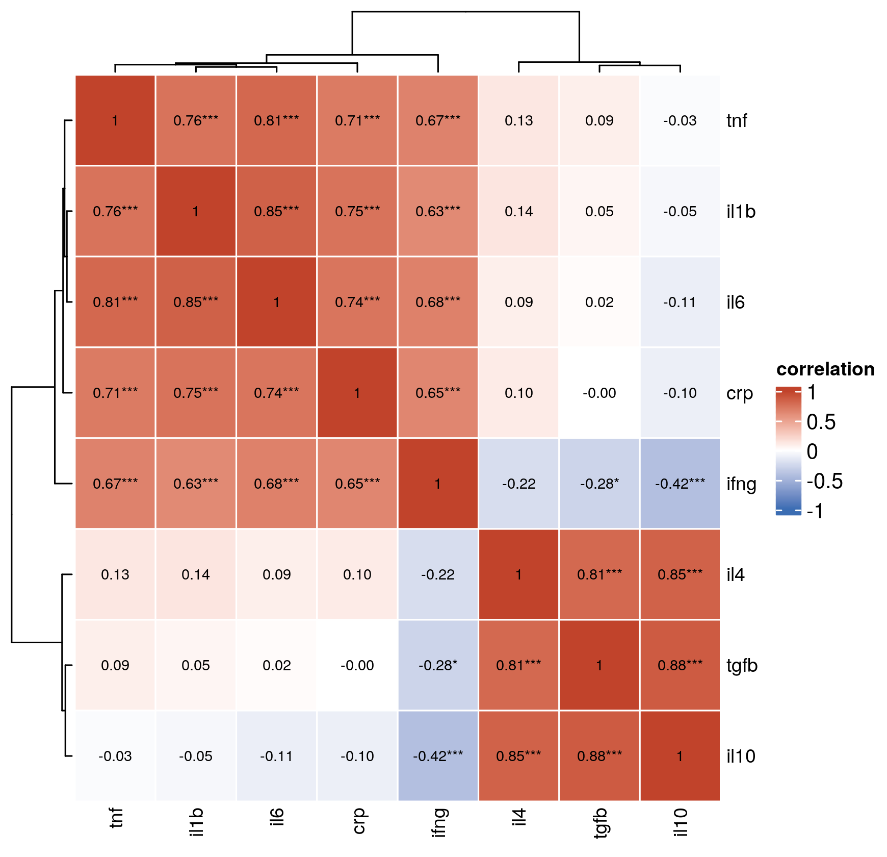

::: {.callout-important}
A manual command generated this report without an LLM model.
No separate human scientific review is part of this fixed recipe.
The report records the selected recipe and does not claim a new method.
:::

## Figure

## Statistical results

| var1 | var2 | r | p_value | p_adj | significant |
| --- | --- | --- | --- | --- | --- |
| il6 | tnf | 0.813394721527696 | 4.88314197760183e-20 | 3.41819938432128e-19 | TRUE |
| il6 | crp | 0.74287025575791 | 3.05183354478947e-15 | 1.06814174067631e-14 | TRUE |
| tnf | crp | 0.714121022694985 | 1.03366794715887e-13 | 3.21585583560536e-13 | TRUE |
| il6 | il1b | 0.848996988062381 | 2.59696890412304e-23 | 3.63575646577225e-22 | TRUE |
| tnf | il1b | 0.756070696504148 | 5.15693933787379e-16 | 2.40657169100777e-15 | TRUE |
| crp | il1b | 0.75465277242778 | 6.27569029835222e-16 | 2.51027611934089e-15 | TRUE |
| il6 | il10 | -0.108754859690453 | 0.336916439236748 | 0.490301864155749 | FALSE |
| tnf | il10 | -0.0262394021297976 | 0.817284973155082 | 0.875484009421239 | FALSE |
| crp | il10 | -0.102048682641098 | 0.367726398116812 | 0.490301864155749 | FALSE |
| il1b | il10 | -0.048000257939418 | 0.672430796097185 | 0.753122491628847 | FALSE |
| il6 | tgfb | 0.0223181910672647 | 0.844216723370481 | 0.875484009421239 | FALSE |
| tnf | tgfb | 0.0874478311325386 | 0.440513439400822 | 0.548946491649106 | FALSE |
| crp | tgfb | -0.00217869197297142 | 0.984697402563014 | 0.984697402563014 | FALSE |
| il1b | tgfb | 0.0530181706208847 | 0.64044670840838 | 0.747187826476443 | FALSE |
| il10 | tgfb | 0.880016761211909 | 6.11578458778511e-27 | 1.71241968457983e-25 | TRUE |
| il6 | il4 | 0.0854773795581015 | 0.450920332426051 | 0.548946491649106 | FALSE |
| tnf | il4 | 0.125574526944716 | 0.267043910458112 | 0.415401638490396 | FALSE |
| crp | il4 | 0.103617085879711 | 0.360370960649279 | 0.490301864155749 | FALSE |
| il1b | il4 | 0.136456280964029 | 0.227452092240348 | 0.37462697545469 | FALSE |
| il10 | il4 | 0.847014448037849 | 4.15149545301648e-23 | 3.87472908948205e-22 | TRUE |
| tgfb | il4 | 0.807607078780738 | 1.42851008511276e-19 | 7.99965647663148e-19 | TRUE |
| il6 | ifng | 0.679352824218468 | 4.28437119357945e-12 | 1.19962393420225e-11 | TRUE |
| tnf | ifng | 0.672585257644432 | 8.34412397944103e-12 | 2.12395883113044e-11 | TRUE |
| crp | ifng | 0.652007096486692 | 5.71342436879992e-11 | 1.33313235271998e-10 | TRUE |
| il1b | ifng | 0.632008679046885 | 3.23444846615311e-10 | 6.96650438863746e-10 | TRUE |
| il10 | ifng | -0.416352151901113 | 0.000122376376907161 | 0.000244752753814321 | TRUE |
| tgfb | ifng | -0.2791726766975 | 0.0121494972301746 | 0.0226790614963259 | TRUE |
| il4 | ifng | -0.220879084267272 | 0.0489645088582451 | 0.0856878905019289 | FALSE |

## Methods

Pairwise pearson correlations among 8 variables were computed and drawn as a heatmap with ComplexHeatmap. Variables were hierarchically clustered on both axes. Each cell shows the coefficient with Benjamini-Hochberg adjusted significance stars (15 of the 28 pairs were significant at adjusted P < 0.05). Rendered in R 4.4.1 with ComplexHeatmap 2.22.0 and circlize 0.4.16.

## Plot configuration

The complete plot configuration is in `plot_config.yaml`.

## Provenance

| field | value |
| --- | --- |
| repository | pubready |
| repository_version | 1.0.0 |
| git_commit | 3e41d3f3097387495c1867696a416bb526e265dc |
| git_dirty | FALSE |
| llm_provider | none |
| llm_model | none |
| agent_harness | manual |
| agent_harness_version | not_recorded |
| container_image | localhost/pubready:1.0.0 |
| container_digest | sha256:21946b0ae6b172f82e028cd57ac788e4b5b7161123799eebaf0ccc68dc590410 |
| input | {"file":"input_correlation_vars.csv","md5":"fda74fb3c6af78c47ab35a25d432893d","sha256":"d31b1677465e09b861a26736371b7359f231a56aff901d33242590e12f23d372"} |
| command | figkit plot --recipe correlation_heatmap |
| analysis_options | {"engine":"r","recipe":"correlation_heatmap","data":{"file":"correlation_vars.csv","x":null,"y":null,"fill":null,"facet":null,"time":null,"event":null,"annotation":null,"id":null,"group":null,"label":null,"positive":null,"se":null,"ci_low":null,"ci_high":null,"measure":null,"ref":null,"cause":null,"markers":null,"covariates":null},"test":{"method":"auto","paired":false,"p_adjust":"none"},"appearance":{"theme":"pubready_house","palette":null,"x_label":null,"y_label":null,"title":null,"y_limits":[null,null],"show_points":true,"geom":"box","bracket":{"show":true,"label":"p.signif"},"scale":"row","cluster":"both","fc_cutoff":1,"p_cutoff":0.05,"top_n":15,"pd_threshold":20,"pr_threshold":-30}} |
| random_seeds | not_applicable |
| session_record | session_info.txt |
| created_utc | 2026-07-18T00:00:00Z |
| review_state | not_applicable |
| reviewer | none |
| quarto_version | 1.11.4 |

The report source reads only files in this bundle.
