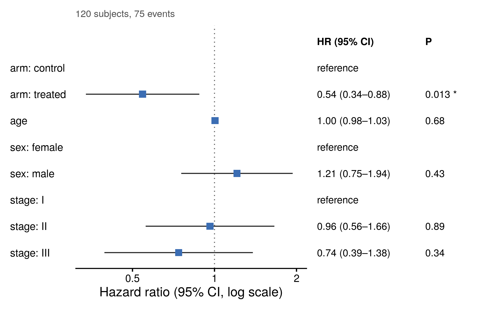

::: {.callout-important}
A manual command generated this report without an LLM model.
No separate human scientific review is part of this fixed recipe.
The report records the selected recipe and does not claim a new method.
:::

## Figure

## Statistical results

| term | HR | ci_low | ci_high | z | p_value |
| --- | --- | --- | --- | --- | --- |
| armtreated | 0.544649434507678 | 0.33720943259687 | 0.879699610491522 | -2.48394806021021 | 0.0129934758234395 |
| age | 1.00451510670282 | 0.983062846650296 | 1.02643549497616 | 0.409017380540824 | 0.682526906244195 |
| sexmale | 1.20922910014746 | 0.754986065460832 | 1.93677086709 | 0.790507593100903 | 0.429231389559849 |
| stageII | 0.962878945763113 | 0.558836737003706 | 1.65904601971029 | -0.136270425100656 | 0.891607503109909 |
| stageIII | 0.738564827833353 | 0.394357448008753 | 1.38320705661023 | -0.946623527113498 | 0.343830650922065 |

## Methods

Hazard ratios were estimated with a Cox proportional-hazards model (120 subjects, 75 events) including arm, age, sex, stage. Significant predictors: armtreated (HR = 0.54, 95% CI 0.34-0.88, P = 0.013). The proportional-hazards assumption was not violated (global cox.zph P = 0.58). Analyses were performed in R 4.4.1 with survival 3.6.4, and the forest plot was drawn with ggplot2 3.5.1 (tidied with broom 1.0.7).

## Plot configuration

The complete plot configuration is in `plot_config.yaml`.

## Provenance

| field | value |
| --- | --- |
| repository | pubready |
| repository_version | 2.0.0 |
| git_commit | a9f218358c74881d725e4bdcd4c40be832ba06c8 |
| git_dirty | FALSE |
| llm_provider | none |
| llm_model | none |
| agent_harness | manual |
| agent_harness_version | not_recorded |
| container_image | localhost/pubready:2.0.0 |
| container_digest | sha256:f22d119d4121702c30e3632421cdf83f9bc1b190c13c3547876874aed2f0419e |
| input | {"file":"input_hazard_ratios.csv","md5":"6f53a662fffe08afdcf72fe041adaf29","sha256":"17dccfaf72c84d69607aa73efad89ed98d9af94e72ddd285bc864fa65346b75e"} |
| command | figkit plot --recipe cox_forest |
| analysis_options | {"engine":"r","recipe":"cox_forest","data":{"file":"survival_trial.csv","x":null,"y":null,"fill":null,"facet":null,"time":"time","event":"event","annotation":null,"id":null,"group":null,"label":null,"positive":null,"se":null,"ci_low":null,"ci_high":null,"measure":null,"ref":null,"cause":null,"levels":null,"markers":null,"covariates":["arm","age","sex","stage"]},"test":{"method":"auto","paired":false,"p_adjust":"none"},"appearance":{"theme":"pubready_house","palette":null,"x_label":null,"y_label":null,"title":null,"y_limits":[null,null],"show_points":true,"geom":"box","bracket":{"show":true,"label":"p.signif"},"scale":"row","cluster":"both","fc_cutoff":1,"p_cutoff":0.05,"top_n":15,"pd_threshold":20,"pr_threshold":-30}} |
| random_seeds | not_applicable |
| session_record | session_info.txt |
| created_utc | 2026-07-18T00:00:00Z |
| review_state | not_applicable |
| reviewer | none |
| quarto_version | 1.11.4 |

The report source reads only files in this bundle.
