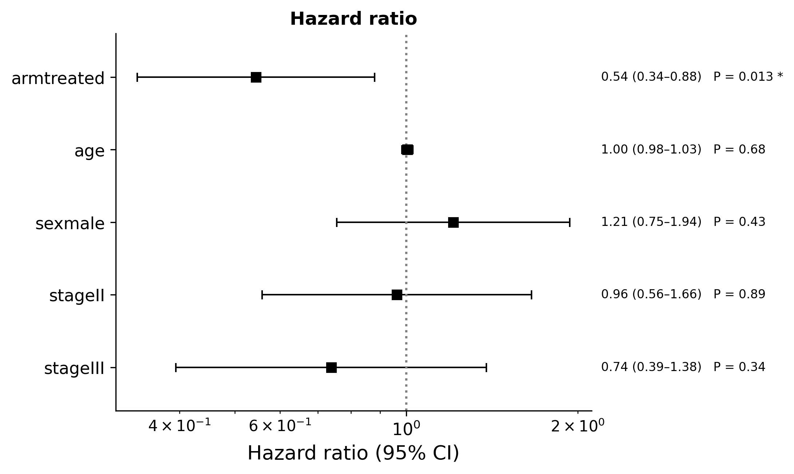

::: {.callout-important}
A manual command generated this report without an LLM model.
No separate human scientific review is part of this fixed recipe.
The report records the selected recipe and does not claim a new statistical method.
:::

## Figure

## Statistical results

| term | HR | ci_low | ci_high | z | p_value |
| --- | --- | --- | --- | --- | --- |
| armtreated | 0.5446495910272949 | 0.3372095343625995 | 0.879699850619351 | -2.48394696006471 | 0.012993515964860746 |
| age | 1.004515095790653 | 0.983062836058313 | 1.0264354837348875 | 0.4090163959255735 | 0.6825276288126748 |
| sexmale | 1.2092289747884706 | 0.7549859866379953 | 1.936770667730414 | 0.7905071605099686 | 0.4292316420949487 |
| stageII | 0.9628789620278184 | 0.5588367376954668 | 1.6590460737049886 | -0.13627036032893464 | 0.8916075543126436 |
| stageIII | 0.7385650617304216 | 0.3943575846309485 | 1.383207453507801 | -0.9466225827526437 | 0.3438311323080432 |

## Methods

Hazard ratios were estimated with a Cox proportional-hazards model (120 subjects, 75 events) including arm, age, sex, stage. Significant predictors: armtreated (HR = 0.54, 95% CI 0.34-0.88, P = 0.013). The proportional-hazards assumption was not violated (minimum covariate cox.zph P = 0.12). Analyses were performed in Python 3.10.12 with lifelines 0.30.0.

## Plot configuration

The complete plot configuration is in `plot_config.yaml`.

## Provenance

| field | value |
| --- | --- |
| repository | pubready |
| repository_version | 0.4.1 |
| git_commit | e8f923bef415cd1719ad862c56f1043770302fc8 |
| git_dirty | False |
| llm_provider | none |
| llm_model | none |
| agent_harness | manual |
| agent_harness_version | not_recorded |
| container_image | localhost/pubready:0.4.1 |
| container_digest | sha256:097c136b375dd40cd790ef1528d70d748ab67d06fc44e73c70de82b4a4782d17 |
| input | {"file": "input_hazard_ratios.csv", "md5": "6f53a662fffe08afdcf72fe041adaf29", "sha256": "17dccfaf72c84d69607aa73efad89ed98d9af94e72ddd285bc864fa65346b75e"} |
| command | figkit plot --recipe cox_forest |
| analysis_options | {"engine": "python", "recipe": "cox_forest", "data": {"file": "survival_trial.csv", "x": null, "y": null, "fill": null, "facet": null, "time": "time", "event": "event", "annotation": null, "covariates": ["arm", "age", "sex", "stage"], "id": null, "group": null, "label": null, "positive": null, "se": null, "ci_low": null, "ci_high": null, "measure": null, "markers": null}, "test": {"method": "auto", "paired": false, "p_adjust": "none"}, "appearance": {"theme": "pubready_house", "palette": null, "x_label": null, "y_label": null, "title": null, "y_limits": [null, null], "show_points": true, "geom": "box", "bracket": {"show": true, "label": "p.signif"}, "scale": "row", "cluster": "both", "fc_cutoff": 1.0, "p_cutoff": 0.05, "top_n": 15, "pd_threshold": 20.0, "pr_threshold": -30.0}} |
| random_seeds | not_applicable |
| session_record | session_info.txt |
| created_utc | 2026-07-18T00:00:00Z |
| review_state | not_applicable |
| reviewer | none |
| quarto_version | 1.11.4 |

The report source reads only files in this bundle.
