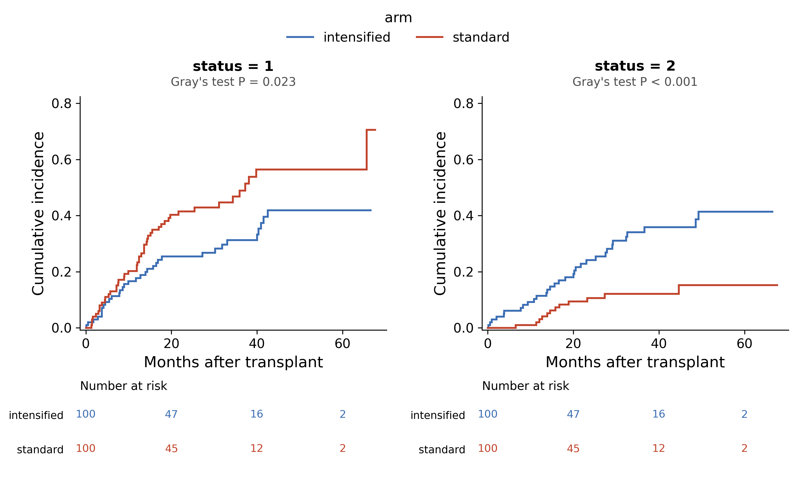

::: {.callout-important}
A manual command generated this report without an LLM model.
No separate human scientific review is part of this fixed recipe.
The report records the selected recipe and does not claim a new statistical method.
:::

## Figure

## Statistical results

| cause | group | n | n_events | cif_20 | cif_30 | cif_50 | gray_statistic | gray_df | gray_p |
| --- | --- | --- | --- | --- | --- | --- | --- | --- | --- |
| 1 | intensified | 100 | 33 | 0.25446657293372144 | 0.2680857084520788 | 0.4188164775554478 | 5.1519003474101845 | 1.0 | 0.023220946687659668 |
| 1 | standard | 100 | 48 | 0.4032736471835053 | 0.4290238874309841 | 0.5646423871319453 | 5.1519003474101845 | 1.0 | 0.023220946687659668 |
| 2 | intensified | 100 | 32 | 0.19243822911906436 | 0.31057228644873935 | 0.41459547497134 | 10.98074482108587 | 1.0 | 0.0009206342190582666 |
| 2 | standard | 100 | 12 | 0.09425297895244814 | 0.12134162362757435 | 0.1527432225516224 | 10.98074482108587 | 1.0 | 0.0009206342190582666 |

## Methods

The cumulative incidence of each event type (status = 1, 2; 0 = censored) was estimated with the Aalen-Johansen estimator in each group of arm (intensified, n = 100; standard, n = 100), which treats the other event types as competing events rather than as censoring. The event type of interest is status = 1. The groups were compared for each event type with Gray's k-sample test (rho = 0): status = 1, chi-square(1) = 5.15, P = 0.023; status = 2, chi-square(1) = 10.98, P < 0.001. The cumulative incidence at months = 20, 30 and 50 is given in the stats table, and the number at risk (the subjects with a follow-up time of t or more) is shown below each panel. Computed in Python 3.10.12 with numpy 1.26.4, restating the cinc and crstm routines of the R package cmprsk, and drawn with matplotlib 3.10.9.

## Plot configuration

The complete plot configuration is in `plot_config.yaml`.

## Provenance

| field | value |
| --- | --- |
| repository | pubready |
| repository_version | 2.0.0 |
| git_commit | 1b8bb2fd31d9315d60137be3bc664c2a3e33f671 |
| git_dirty | False |
| llm_provider | none |
| llm_model | none |
| agent_harness | manual |
| agent_harness_version | not_recorded |
| container_image | localhost/pubready:2.0.0 |
| container_digest | sha256:f22d119d4121702c30e3632421cdf83f9bc1b190c13c3547876874aed2f0419e |
| input | {"file": "input_status.csv", "md5": "f51b7f002d22481f599b4424a27f3bdc", "sha256": "d51f82fe2977bbed1ce2d5a6dac5172c07d0735d16d33c39715d0b67ab610486"} |
| command | figkit plot --recipe cumulative_incidence |
| analysis_options | {"engine": "python", "recipe": "cumulative_incidence", "data": {"file": "cumulative_incidence.csv", "x": "arm", "y": null, "fill": null, "facet": null, "time": "months", "event": "status", "annotation": null, "covariates": null, "id": null, "group": null, "label": null, "positive": null, "se": null, "ci_low": null, "ci_high": null, "measure": null, "ref": null, "cause": null, "levels": null, "markers": null}, "test": {"method": "auto", "paired": false, "p_adjust": "none"}, "appearance": {"theme": "pubready_house", "palette": null, "x_label": "Months after transplant", "y_label": null, "title": null, "y_limits": [null, null], "show_points": true, "geom": "box", "bracket": {"show": true, "label": "p.signif"}, "scale": "row", "cluster": "both", "fc_cutoff": 1.0, "p_cutoff": 0.05, "top_n": 15, "pd_threshold": 20.0, "pr_threshold": -30.0}} |
| random_seeds | not_applicable |
| session_record | session_info.txt |
| created_utc | 2026-07-18T00:00:00Z |
| review_state | not_applicable |
| reviewer | none |
| quarto_version | 1.11.4 |

The report source reads only files in this bundle.
