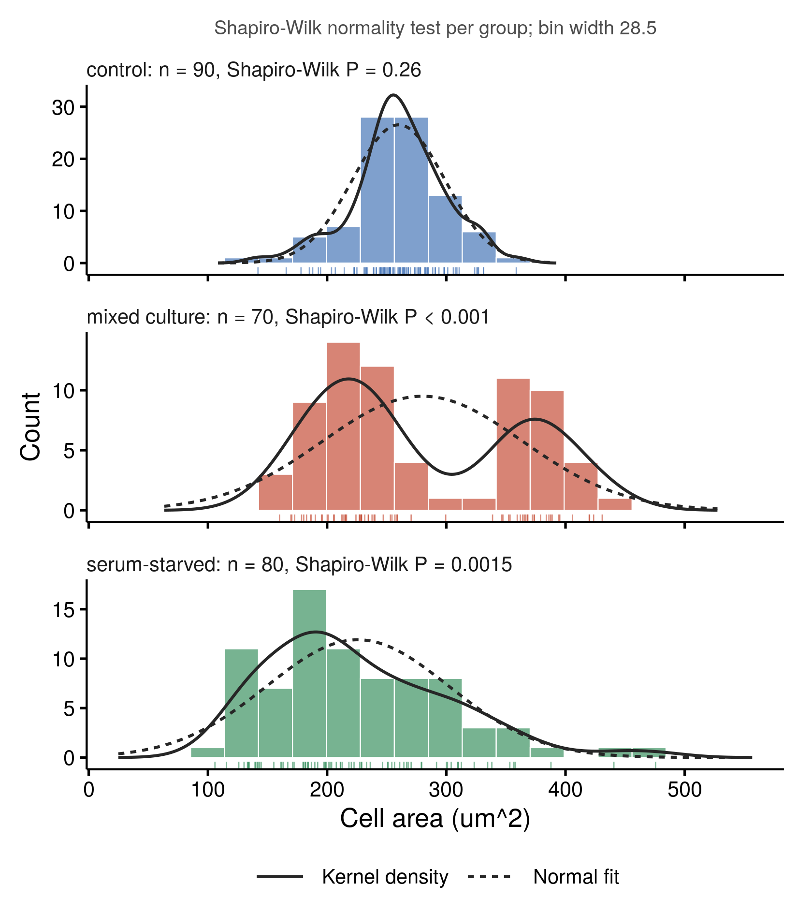

::: {.callout-important}
A manual command generated this report without an LLM model.
No separate human scientific review is part of this fixed recipe.
The report records the selected recipe and does not claim a new method.
:::

## Figure

## Statistical results

| group | n | mean | sd | median | q1 | q3 | min | max | skewness | excess_kurtosis | shapiro_w | shapiro_p | bin_width | bandwidth |
| --- | --- | --- | --- | --- | --- | --- | --- | --- | --- | --- | --- | --- | --- | --- |
| control | 90 | 260.026666666667 | 38.5616616966773 | 260.5 | 241.95 | 282.8 | 142 | 358.7 | -0.283251836374822 | 0.557303144647182 | 0.982386599742929 | 0.263455660084079 | 28.4899825907378 | 11.1553004052368 |
| mixed culture | 70 | 280.064285714286 | 83.7470346188653 | 243.6 | 213.125 | 366.225 | 160.1 | 430.8 | 0.332139008932912 | -1.49052060435712 | 0.883168178205978 | 8.92447160964918e-06 | 28.4899825907378 | 32.2249564849822 |
| serum-starved | 80 | 225.72375 | 76.3426042669873 | 209.4 | 172 | 268.625 | 105.9 | 475.6 | 0.862750774456073 | 0.529639011323686 | 0.943427786403581 | 0.00147682579719918 | 28.4899825907378 | 27.0152642905542 |

## Methods

The distribution of cell_area_um2 was described in each of 3 groups of condition (n = 90, 70, 80). The histogram uses a bin width of 28.49 from the Freedman-Diaconis rule (2 x IQR x n^(-1/3)) on the pooled values, with bins anchored at a multiple of the width. The solid curve is a Gaussian kernel density with the bandwidth of Silverman's rule of thumb (stats::bw.nrd0), and the dashed curve is a normal distribution with the sample mean and SD; both are scaled to counts. Normality was assessed with the Shapiro-Wilk test (control: W = 0.982, P = 0.26; mixed culture: W = 0.883, P < 0.001; serum-starved: W = 0.943, P = 0.0015). Skewness and excess kurtosis are the moment estimates on standardised values (sum(z^3) / n and sum(z^4) / n - 3, with z scaled by the SD). No test compared the groups; use two_group_compare or multi_group_compare to test a difference in location. Computed in R 4.4.1 and drawn with ggplot2 3.5.1.

## Plot configuration

The complete plot configuration is in `plot_config.yaml`.

## Provenance

| field | value |
| --- | --- |
| repository | pubready |
| repository_version | 3.0.0 |
| git_commit | 4657df8148b43cbd66ec3a2bc04a756a38e7843c |
| git_dirty | FALSE |
| llm_provider | none |
| llm_model | none |
| agent_harness | manual |
| agent_harness_version | not_recorded |
| container_image | localhost/pubready:3.0.0 |
| container_digest | sha256:6af675049bd5433b2d94050941a2f5aaa8644e1656f74e21f139a93e36308290 |
| input | {"file":"input_cell_area_um2.csv","md5":"9a6485554175f36ec3bd2b8365cc3665","sha256":"5465c7bdc86c61c1bbdaa5bf4d211be7062d1eadd2b12df0a28b2cecba8052bb"} |
| command | figkit plot --recipe distribution |
| analysis_options | {"engine":"r","recipe":"distribution","data":{"file":"distribution.csv","x":"condition","y":"cell_area_um2","fill":null,"facet":null,"time":null,"event":null,"annotation":null,"id":null,"group":null,"label":null,"positive":null,"se":null,"ci_low":null,"ci_high":null,"measure":null,"ref":null,"cause":null,"levels":null,"markers":null,"covariates":null},"test":{"method":"auto","paired":false,"p_adjust":"none"},"appearance":{"theme":"pubready_house","palette":null,"x_label":"Cell area (um^2)","y_label":null,"title":null,"y_limits":[null,null],"show_points":true,"geom":"box","bracket":{"show":true,"label":"p.signif"},"scale":"row","cluster":"both","fc_cutoff":1,"p_cutoff":0.05,"top_n":15,"pd_threshold":20,"pr_threshold":-30}} |
| random_seeds | not_applicable |
| session_record | session_info.txt |
| created_utc | 2026-07-18T00:00:00Z |
| review_state | not_applicable |
| reviewer | none |
| quarto_version | 1.11.4 |

The report source reads only files in this bundle.
