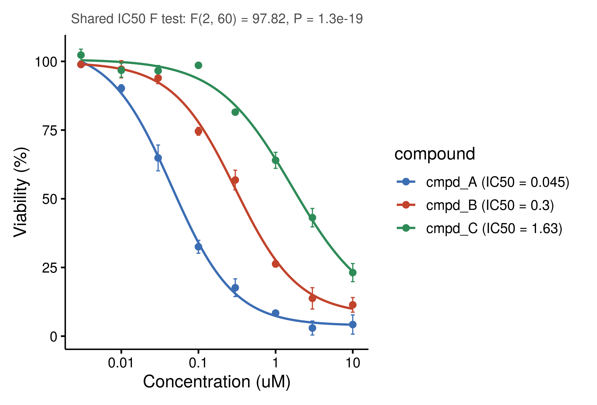

::: {.callout-important}
A manual command generated this report without an LLM model.
No separate human scientific review is part of this fixed recipe.
The report records the selected recipe and does not claim a new method.
:::

## Figure

## Statistical results

| group | n | doses | midpoint | bottom | top | hill | log_ec50 | se_log_ec50 | ec50 | ec50_ci_low | ec50_ci_high | r_squared | rss | df_resid | fit_status | status_reason |
| --- | --- | --- | --- | --- | --- | --- | --- | --- | --- | --- | --- | --- | --- | --- | --- | --- |
| cmpd_A | 24 | 8 | IC50 | 3.86534727236066 | 105.178129885971 | -1.07526448528466 | -1.34715628606748 | 0.0533375109306633 | 0.0449618025348884 | 0.0348003503152443 | 0.0580903257833226 | 0.987614022191358 | 406.057886518213 | 20 | fitted |  |
| cmpd_B | 24 | 8 | IC50 | 7.82212504156196 | 99.6244909050535 | -1.06538771230869 | -0.523574215516967 | 0.0505406512129161 | 0.299519970637304 | 0.234963191978491 | 0.381813900531211 | 0.986629864356914 | 401.066761043231 | 20 | fitted |  |
| cmpd_C | 24 | 8 | IC50 | 8.14930162400738 | 100.750498389634 | -0.890261817522493 | 0.212433862670487 | 0.128567479198864 | 1.63092452199143 | 0.879522189075189 | 3.02427253055417 | 0.977555408994383 | 417.362098207554 | 20 | fitted |  |

## Methods

Viability (%) was modelled as a function of Concentration (uM) with a four-parameter logistic curve (variable Hill slope) fitted by nonlinear least squares on log10 dose (n = 72 points, 3 curve(s)). The 95% confidence interval of the midpoint was computed on the log10 scale from the standard error of the fit and back-transformed. A midpoint was reported as not determined when the fit did not converge, when the fitted span (top minus bottom) was below 10% of the range of the mean responses, when the midpoint lay outside the tested doses, or when its 95% CI was not finite. cmpd_A: IC50 = 0.045 (95% CI 0.0348 to 0.0581, Hill slope -1.08, R2 = 0.988); cmpd_B: IC50 = 0.3 (95% CI 0.235 to 0.382, Hill slope -1.07, R2 = 0.987); cmpd_C: IC50 = 1.63 (95% CI 0.88 to 3.02, Hill slope -0.89, R2 = 0.978). An extra-sum-of-squares F test compared one shared IC50 with one IC50 per curve over the 3 determined curves, with the shared fit profiled over the midpoint and each Hill slope held between 0.05 and 20 in magnitude: F(2, 60) = 97.82, P = 1.3e-19. Fitted in R 4.4.1 with stats::nls and drawn with ggplot2 3.5.1.

## Plot configuration

The complete plot configuration is in `plot_config.yaml`.

## Provenance

| field | value |
| --- | --- |
| repository | pubready |
| repository_version | 1.0.0 |
| git_commit | 3e41d3f3097387495c1867696a416bb526e265dc |
| git_dirty | FALSE |
| llm_provider | none |
| llm_model | none |
| agent_harness | manual |
| agent_harness_version | not_recorded |
| container_image | localhost/pubready:1.0.0 |
| container_digest | sha256:21946b0ae6b172f82e028cd57ac788e4b5b7161123799eebaf0ccc68dc590410 |
| input | {"file":"input_viability_pct.csv","md5":"065caf43fa8bffd4422569a6a1bbece0","sha256":"c6b98694438d373a93c7934f5421def4892b3a726d40429bcf0025e87e231590"} |
| command | figkit plot --recipe dose_response |
| analysis_options | {"engine":"r","recipe":"dose_response","data":{"file":"dose_response.csv","x":"concentration_um","y":"viability_pct","fill":null,"facet":null,"time":null,"event":null,"annotation":null,"id":null,"group":"compound","label":null,"positive":null,"se":null,"ci_low":null,"ci_high":null,"measure":null,"ref":null,"cause":null,"markers":null,"covariates":null},"test":{"method":"auto","paired":false,"p_adjust":"none"},"appearance":{"theme":"pubready_house","palette":null,"x_label":"Concentration (uM)","y_label":"Viability (%)","title":null,"y_limits":[null,null],"show_points":true,"geom":"box","bracket":{"show":true,"label":"p.signif"},"scale":"row","cluster":"both","fc_cutoff":1,"p_cutoff":0.05,"top_n":15,"pd_threshold":20,"pr_threshold":-30}} |
| random_seeds | not_applicable |
| session_record | session_info.txt |
| created_utc | 2026-07-18T00:00:00Z |
| review_state | not_applicable |
| reviewer | none |
| quarto_version | 1.11.4 |

The report source reads only files in this bundle.
