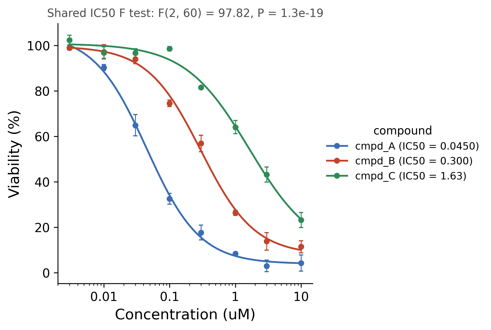

::: {.callout-important}
A manual command generated this report without an LLM model.
No separate human scientific review is part of this fixed recipe.
The report records the selected recipe and does not claim a new statistical method.
:::

## Figure

## Statistical results

| group | n | doses | midpoint_type | bottom | top | hill | log_midpoint | se_log_midpoint | midpoint | midpoint_ci_low | midpoint_ci_high | r_squared | rss | df_resid | fit_status | status_reason |
| --- | --- | --- | --- | --- | --- | --- | --- | --- | --- | --- | --- | --- | --- | --- | --- | --- |
| cmpd_A | 24 | 8 | IC50 | 3.8653473492336854 | 105.17812986516586 | -1.0752644847906188 | -1.347156285886076 | 0.0533375135399695 | 0.044961802553668995 | 0.034800349893635465 | 0.058090326535620095 | 0.9876140221913577 | 406.05788651821354 | 20 | fitted |  |
| cmpd_B | 24 | 8 | IC50 | 7.822126855689921 | 99.62449027906047 | -1.065387798072742 | -0.5235742378227778 | 0.05054063712932387 | 0.299519955253651 | 0.2349631958046305 | 0.3818138550930498 | 0.9866298643569151 | 401.0667610432132 | 20 | fitted |  |
| cmpd_C | 24 | 8 | IC50 | 8.149290227445647 | 100.75050182089066 | -0.8902615068755195 | 0.2124339489536989 | 0.128567497549589 | 1.6309248460144736 | 0.8795222862922365 | 3.0242733979608696 | 0.9775554089943896 | 417.3620982074334 | 20 | fitted |  |

## Methods

Viability (%) was modelled as a function of Concentration (uM) with a four-parameter logistic curve (variable Hill slope) fitted by nonlinear least squares on log10 dose (n = 72 points, 3 curve(s)). The 95% confidence interval of the midpoint was computed on the log10 scale from the standard error of the fit and back-transformed. Points show the mean +/- SEM of the replicates at each dose. A curve whose mean responses varied by less than 10% of the range of the mean responses of all curves, or whose responses did not differ between the doses in a one-way ANOVA (P >= 0.05), was not fitted, and its midpoint was reported as not determined. A midpoint was also reported as not determined when the fit did not converge, when the fitted span (top minus bottom) was below 10% of the range of the mean responses, when the midpoint lay outside the tested doses, or when its 95% CI was not finite. cmpd_A: IC50 = 0.0450 (95% CI 0.0348 to 0.0581, Hill slope -1.08, R2 = 0.988); cmpd_B: IC50 = 0.300 (95% CI 0.235 to 0.382, Hill slope -1.07, R2 = 0.987); cmpd_C: IC50 = 1.63 (95% CI 0.880 to 3.02, Hill slope -0.89, R2 = 0.978). An extra-sum-of-squares F test compared one shared IC50 with one IC50 per curve over the 3 determined curves, with the shared fit profiled over the midpoint and each Hill slope held between 0.05 and 20 in magnitude: F(2, 60) = 97.82, P = 1.3e-19. Fitted in Python 3.10.12 with scipy 1.15.3 (curve_fit) and drawn with matplotlib 3.10.9.

## Plot configuration

The complete plot configuration is in `plot_config.yaml`.

## Provenance

| field | value |
| --- | --- |
| repository | pubready |
| repository_version | 4.0.0 |
| git_commit | 567ce8900bdb5db88369d131c8d787b042b3af57 |
| git_dirty | FALSE |
| llm_provider | none |
| llm_model | none |
| agent_harness | manual |
| agent_harness_version | not_recorded |
| container_image | localhost/pubready:4.0.0 |
| container_digest | sha256:0f57027a3fbca5ec9d41d74ca91226fbdf45d94b1a85f271637d12733db5d483 |
| input | {"file": "input_viability_pct.csv", "md5": "065caf43fa8bffd4422569a6a1bbece0", "sha256": "c6b98694438d373a93c7934f5421def4892b3a726d40429bcf0025e87e231590"} |
| command | figkit plot --recipe dose_response |
| analysis_options | {"engine": "python", "recipe": "dose_response", "data": {"file": "dose_response.csv", "x": "concentration_um", "y": "viability_pct", "fill": null, "facet": null, "time": null, "event": null, "annotation": null, "covariates": null, "id": null, "group": "compound", "label": null, "positive": null, "se": null, "ci_low": null, "ci_high": null, "measure": null, "ref": null, "cause": null, "levels": null, "visit_levels": null, "features": null, "markers": null}, "test": {"method": "auto", "paired": false}, "appearance": {"theme": "pubready_house", "palette": null, "x_label": "Concentration (uM)", "y_label": "Viability (%)", "title": null, "y_limits": [null, null], "show_points": true, "geom": "box", "bracket": {"show": true, "label": "p.signif"}, "scale": "row", "cluster": "both", "fc_cutoff": 1.0, "p_cutoff": 0.05, "top_n": 15, "pd_threshold": 20.0, "pr_threshold": -30.0}} |
| random_seeds | not_applicable |
| session_record | session_info.txt |
| created_utc | 2026-07-18T00:00:00Z |
| review_state | not_applicable |
| reviewer | none |
| quarto_version | 1.11.4 |

The report source reads only files in this bundle.
