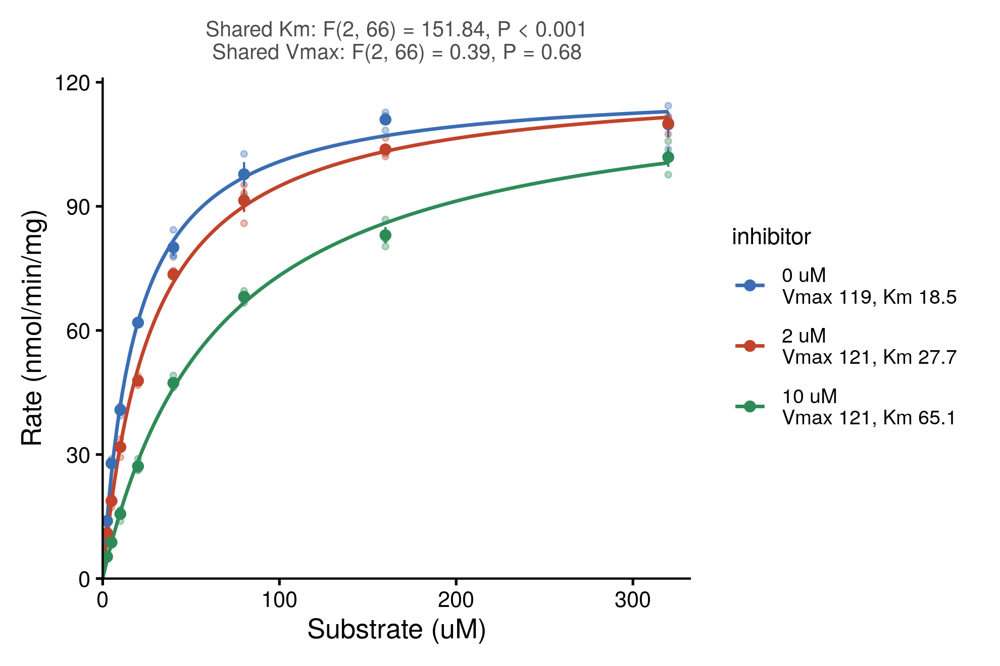

::: {.callout-important}
A manual command generated this report without an LLM model.
No separate human scientific review is part of this fixed recipe.
The report records the selected recipe and does not claim a new method.
:::

## Figure

## Statistical results

| group | n | concentrations | vmax | vmax_se | vmax_ci_low | vmax_ci_high | km | km_se | km_ci_low | km_ci_high | residual_sd | r_squared | rss | df_resid |
| --- | --- | --- | --- | --- | --- | --- | --- | --- | --- | --- | --- | --- | --- | --- |
| 0 uM | 24 | 8 | 119.420721778837 | 1.66720649921811 | 115.963147121474 | 122.8782964362 | 18.4543092239766 | 0.96344767541413 | 16.4562410376005 | 20.4523774103527 | 3.43304912667419 | 0.991352083168473 | 259.288178735485 | 22 |
| 2 uM | 24 | 8 | 121.184557299952 | 1.45857539434123 | 118.15965707212 | 124.209457527784 | 27.6947005620092 | 1.13820957738582 | 25.3341983738383 | 30.05520275018 | 2.5498774779663 | 0.995525965155346 | 143.041253358075 | 22 |
| 10 uM | 24 | 8 | 120.985687826055 | 2.2028594019331 | 116.417237040006 | 125.554138612103 | 65.1390679372729 | 3.24615555244453 | 58.4069533628311 | 71.8711825117148 | 2.401729813176 | 0.995461099372303 | 126.902734100966 | 22 |

## Methods

Rate (nmol/min/mg) was modelled as a function of Substrate (uM) with the Michaelis-Menten equation v = Vmax S / (Km + S), fitted by nonlinear least squares to each level of inhibitor (3 curves) (n = 72 points). The starting values were the largest rate for Vmax and, for Km, the substrate concentration whose mean rate is nearest half of it. Each 95% confidence interval is the estimate plus or minus t(0.975, n - 2) times its asymptotic standard error. 0 uM: Vmax = 119 (95% CI 116 to 123), Km = 18.5 (95% CI 16.5 to 20.5), R2 = 0.991; 2 uM: Vmax = 121 (95% CI 118 to 124), Km = 27.7 (95% CI 25.3 to 30.1), R2 = 0.996; 10 uM: Vmax = 121 (95% CI 116 to 126), Km = 65.1 (95% CI 58.4 to 71.9), R2 = 0.995. Extra-sum-of-squares F tests compared the separate fits with one shared Km (a Vmax for each curve) and with one shared Vmax (a Km for each curve): shared Km F(2, 66) = 151.84, P = 2e-25; shared Vmax F(2, 66) = 0.39, P = 0.68. Fitted in R 4.4.1 with stats::nls and drawn with ggplot2 3.5.1.

## Plot configuration

The complete plot configuration is in `plot_config.yaml`.

## Provenance

| field | value |
| --- | --- |
| repository | pubready |
| repository_version | 1.0.0 |
| git_commit | 3e41d3f3097387495c1867696a416bb526e265dc |
| git_dirty | FALSE |
| llm_provider | none |
| llm_model | none |
| agent_harness | manual |
| agent_harness_version | not_recorded |
| container_image | localhost/pubready:1.0.0 |
| container_digest | sha256:21946b0ae6b172f82e028cd57ac788e4b5b7161123799eebaf0ccc68dc590410 |
| input | {"file":"input_rate.csv","md5":"6a7e13da412e358ca8b433bb29431af9","sha256":"2749d9ead24bd1313af8ecc106ec1fafebf1748a7b69b0d41210f5a35e5a4db8"} |
| command | figkit plot --recipe enzyme_kinetics |
| analysis_options | {"engine":"r","recipe":"enzyme_kinetics","data":{"file":"enzyme_kinetics.csv","x":"substrate_um","y":"rate","fill":null,"facet":null,"time":null,"event":null,"annotation":null,"id":null,"group":"inhibitor","label":null,"positive":null,"se":null,"ci_low":null,"ci_high":null,"measure":null,"ref":null,"cause":null,"markers":null,"covariates":null},"test":{"method":"auto","paired":false,"p_adjust":"none"},"appearance":{"theme":"pubready_house","palette":null,"x_label":"Substrate (uM)","y_label":"Rate (nmol/min/mg)","title":null,"y_limits":[null,null],"show_points":true,"geom":"box","bracket":{"show":true,"label":"p.signif"},"scale":"row","cluster":"both","fc_cutoff":1,"p_cutoff":0.05,"top_n":15,"pd_threshold":20,"pr_threshold":-30}} |
| random_seeds | not_applicable |
| session_record | session_info.txt |
| created_utc | 2026-07-18T00:00:00Z |
| review_state | not_applicable |
| reviewer | none |
| quarto_version | 1.11.4 |

The report source reads only files in this bundle.
