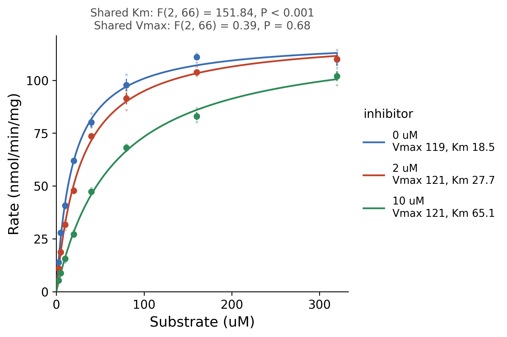

::: {.callout-important}
A manual command generated this report without an LLM model.
No separate human scientific review is part of this fixed recipe.
The report records the selected recipe and does not claim a new statistical method.
:::

## Figure

## Statistical results

| group | n | concentrations | vmax | vmax_se | vmax_ci_low | vmax_ci_high | km | km_se | km_ci_low | km_ci_high | residual_sd | r_squared | rss | df_resid |
| --- | --- | --- | --- | --- | --- | --- | --- | --- | --- | --- | --- | --- | --- | --- |
| 0 uM | 24 | 8 | 119.42072174260247 | 1.6672064697034046 | 115.96314714644924 | 122.87829633875569 | 18.454309201337395 | 0.9634476566266041 | 16.456241053924245 | 20.452377348750545 | 3.4330491266741867 | 0.9913520831684726 | 259.2881787354847 | 22 |
| 2 uM | 24 | 8 | 121.18455734002796 | 1.4585754333977405 | 118.15965703119797 | 124.20945764885796 | 27.694700593375806 | 1.1382096278730323 | 25.334198300500873 | 30.05520288625074 | 2.5498774779663007 | 0.995525965155346 | 143.0412533580752 | 22 |
| 10 uM | 24 | 8 | 120.98568787615388 | 2.2028594259826195 | 116.41723704023002 | 125.55413871207773 | 65.13906802060127 | 3.246155474584694 | 58.406953607630896 | 71.87118243357165 | 2.401729813176005 | 0.9954610993723033 | 126.90273410096587 | 22 |

## Methods

Rate (nmol/min/mg) was modelled as a function of Substrate (uM) with the Michaelis-Menten equation v = Vmax S / (Km + S), fitted by nonlinear least squares to each level of inhibitor (3 curves) (n = 72 points). The starting values were the largest rate for Vmax and, for Km, the substrate concentration whose mean rate is nearest half of it. Each 95% confidence interval is the estimate plus or minus t(0.975, n - 2) times its asymptotic standard error. 0 uM: Vmax = 119 (95% CI 116 to 123), Km = 18.5 (95% CI 16.5 to 20.5), R2 = 0.991; 2 uM: Vmax = 121 (95% CI 118 to 124), Km = 27.7 (95% CI 25.3 to 30.1), R2 = 0.996; 10 uM: Vmax = 121 (95% CI 116 to 126), Km = 65.1 (95% CI 58.4 to 71.9), R2 = 0.995. Extra-sum-of-squares F tests compared the separate fits with one shared Km (a Vmax for each curve) and with one shared Vmax (a Km for each curve): shared Km F(2, 66) = 151.84, P = 2e-25; shared Vmax F(2, 66) = 0.39, P = 0.68. Fitted in Python 3.10.12 with scipy 1.15.3 (curve_fit) and drawn with matplotlib 3.10.9.

## Plot configuration

The complete plot configuration is in `plot_config.yaml`.

## Provenance

| field | value |
| --- | --- |
| repository | pubready |
| repository_version | 2.0.0 |
| git_commit | 1b8bb2fd31d9315d60137be3bc664c2a3e33f671 |
| git_dirty | False |
| llm_provider | none |
| llm_model | none |
| agent_harness | manual |
| agent_harness_version | not_recorded |
| container_image | localhost/pubready:2.0.0 |
| container_digest | sha256:f22d119d4121702c30e3632421cdf83f9bc1b190c13c3547876874aed2f0419e |
| input | {"file": "input_rate.csv", "md5": "6a7e13da412e358ca8b433bb29431af9", "sha256": "2749d9ead24bd1313af8ecc106ec1fafebf1748a7b69b0d41210f5a35e5a4db8"} |
| command | figkit plot --recipe enzyme_kinetics |
| analysis_options | {"engine": "python", "recipe": "enzyme_kinetics", "data": {"file": "enzyme_kinetics.csv", "x": "substrate_um", "y": "rate", "fill": null, "facet": null, "time": null, "event": null, "annotation": null, "covariates": null, "id": null, "group": "inhibitor", "label": null, "positive": null, "se": null, "ci_low": null, "ci_high": null, "measure": null, "ref": null, "cause": null, "levels": null, "markers": null}, "test": {"method": "auto", "paired": false, "p_adjust": "none"}, "appearance": {"theme": "pubready_house", "palette": null, "x_label": "Substrate (uM)", "y_label": "Rate (nmol/min/mg)", "title": null, "y_limits": [null, null], "show_points": true, "geom": "box", "bracket": {"show": true, "label": "p.signif"}, "scale": "row", "cluster": "both", "fc_cutoff": 1.0, "p_cutoff": 0.05, "top_n": 15, "pd_threshold": 20.0, "pr_threshold": -30.0}} |
| random_seeds | not_applicable |
| session_record | session_info.txt |
| created_utc | 2026-07-18T00:00:00Z |
| review_state | not_applicable |
| reviewer | none |
| quarto_version | 1.11.4 |

The report source reads only files in this bundle.
