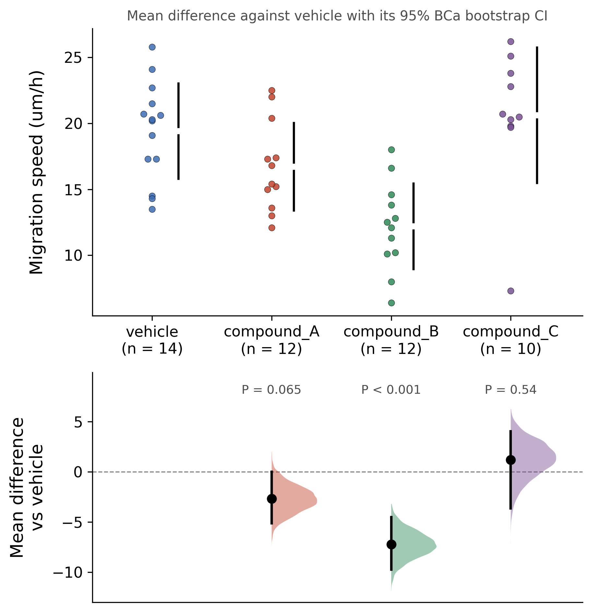

::: {.callout-important}
A manual command generated this report without an LLM model.
No separate human scientific review is part of this fixed recipe.
The report records the selected recipe and does not claim a new statistical method.
:::

## Figure

## Statistical results

| reference | group | n_ref | n_group | mean_ref | mean_group | mean_diff | ci_low | ci_high | hedges_g | test | statistic | df | p_value |
| --- | --- | --- | --- | --- | --- | --- | --- | --- | --- | --- | --- | --- | --- |
| vehicle | compound_A | 14 | 12 | 19.421428571428574 | 16.725 | -2.696428571428573 | -5.1392857142857125 | 0.01350156651134313 | -0.7333908974537607 | Welch two-sample t-test | -1.937390702071394 | 23.842029616838975 | 0.06463183184408533 |
| vehicle | compound_B | 14 | 12 | 19.421428571428574 | 12.200000000000001 | -7.221428571428573 | -9.761612234322834 | -4.515173322916885 | -1.9814052998767422 | Welch two-sample t-test | -5.243056987250348 | 23.913387458531183 | 2.2730934736168304e-05 |
| vehicle | compound_C | 14 | 10 | 19.421428571428574 | 20.62 | 1.1985714285714266 | -3.649933600558813 | 4.022126258908432 | 0.26427268514816044 | Welch two-sample t-test | 0.6235786539821652 | 15.219640306164493 | 0.5421378032741621 |

## Methods

Migration speed (um/h) was analysed with estimation statistics, with vehicle as the reference group (n = 14). For each group the mean difference against vehicle (group minus reference) is reported with a 95% bias-corrected and accelerated (BCa) bootstrap confidence interval from 5000 resamples. The resamples were drawn with the Park-Miller minimal standard generator (multiplier 48271, modulus 2^31 - 1, seed 20261029, restarted for each comparison), each resample drawing the reference indices first and then the group indices, as floor(u n). The bias correction is the normal quantile of the proportion of bootstrap differences strictly below the estimate, the acceleration comes from the jackknife of the mean difference over every observation of both groups, and the interval ends are type-7 quantiles. Hedges' g is Cohen's d over the pooled standard deviation with the exact small-sample correction. A Welch two-sample t-test gives each P value, with no adjustment for the 3 comparisons against vehicle. compound_A: mean difference -2.70 (95% CI -5.14 to 0.0135), Hedges' g = -0.73, t(23.8) = -1.94, P = 0.065; compound_B: mean difference -7.22 (95% CI -9.76 to -4.52), Hedges' g = -1.98, t(23.9) = -5.24, P = 2.3e-05; compound_C: mean difference 1.20 (95% CI -3.65 to 4.02), Hedges' g = 0.26, t(15.2) = 0.62, P = 0.54. Computed in Python 3.10.12 with numpy 1.26.4 and scipy 1.15.3 and drawn with matplotlib 3.10.9.

## Plot configuration

The complete plot configuration is in `plot_config.yaml`.

## Provenance

| field | value |
| --- | --- |
| repository | pubready |
| repository_version | 2.0.0 |
| git_commit | a9f218358c74881d725e4bdcd4c40be832ba06c8 |
| git_dirty | False |
| llm_provider | none |
| llm_model | none |
| agent_harness | manual |
| agent_harness_version | not_recorded |
| container_image | localhost/pubready:2.0.0 |
| container_digest | sha256:f22d119d4121702c30e3632421cdf83f9bc1b190c13c3547876874aed2f0419e |
| input | {"file": "input_speed_um_h.csv", "md5": "5339e052f2d5f5e0a25c5088c57c88b0", "sha256": "e811a230beb670c6360616da156ecfeaa53ff2e5895bd99d59958015656bdecc"} |
| command | figkit plot --recipe estimation_plot |
| analysis_options | {"engine": "python", "recipe": "estimation_plot", "data": {"file": "estimation_plot.csv", "x": "treatment", "y": "speed_um_h", "fill": null, "facet": null, "time": null, "event": null, "annotation": null, "covariates": null, "id": null, "group": null, "label": null, "positive": null, "se": null, "ci_low": null, "ci_high": null, "measure": null, "ref": "vehicle", "cause": null, "levels": null, "markers": null}, "test": {"method": "auto", "paired": false, "p_adjust": "none"}, "appearance": {"theme": "pubready_house", "palette": null, "x_label": null, "y_label": "Migration speed (um/h)", "title": null, "y_limits": [null, null], "show_points": true, "geom": "box", "bracket": {"show": true, "label": "p.signif"}, "scale": "row", "cluster": "both", "fc_cutoff": 1.0, "p_cutoff": 0.05, "top_n": 15, "pd_threshold": 20.0, "pr_threshold": -30.0}} |
| random_seeds | not_applicable |
| session_record | session_info.txt |
| created_utc | 2026-07-18T00:00:00Z |
| review_state | not_applicable |
| reviewer | none |
| quarto_version | 1.11.4 |

The report source reads only files in this bundle.
