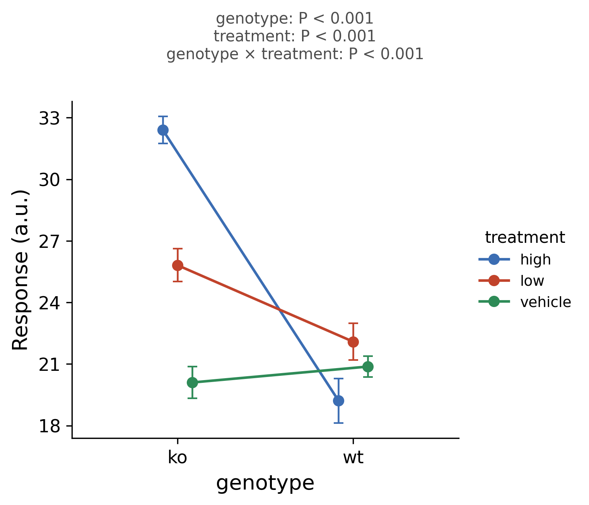

::: {.callout-important}
A manual command generated this report without an LLM model.
No separate human scientific review is part of this fixed recipe.
The report records the selected recipe and does not claim a new statistical method.
:::

## Figure

## Statistical results

| effect | df1 | df2 | statistic | p_value | effect_size | effect_size_name | significant |
| --- | --- | --- | --- | --- | --- | --- | --- |
| genotype | 1 | 42 | 67.34103515749051 | 2.889410307080023e-10 | 0.6158807172485166 | partial eta squared | True |
| treatment | 2 | 42 | 22.612776985725574 | 2.1613078714188581e-07 | 0.51848973050092 | partial eta squared | True |
| genotype:treatment | 2 | 42 | 39.4009950995388 | 2.315683617100895e-10 | 0.6523236088181542 | partial eta squared | True |

## Methods

Response (a.u.) was analyzed by a 2-way ANOVA (Type II sums of squares) with factors genotype, treatment. Effects tested: genotype (F(1, 42) = 67.34, P < 0.001); treatment (F(2, 42) = 22.61, P < 0.001); genotype x treatment (F(2, 42) = 39.40, P < 0.001). Effect sizes are partial eta squared. Significance was set at P < 0.05. Analyses were performed in Python 3.10.12 with statsmodels 0.15.0; figures were produced with seaborn 0.13.2. (The Python engine uses parametric ANOVA only; the aligned rank transform is R-only.)

## Plot configuration

The complete plot configuration is in `plot_config.yaml`.

## Provenance

| field | value |
| --- | --- |
| repository | pubready |
| repository_version | 1.0.0 |
| git_commit | 08e20b9ab068444757d8a4eefce4044219afc94d |
| git_dirty | False |
| llm_provider | none |
| llm_model | none |
| agent_harness | manual |
| agent_harness_version | not_recorded |
| container_image | localhost/pubready:1.0.0 |
| container_digest | sha256:21946b0ae6b172f82e028cd57ac788e4b5b7161123799eebaf0ccc68dc590410 |
| input | {"file": "input_response.csv", "md5": "dba50f83c02a1cd007bc013dd062a9b0", "sha256": "e7d2443929aced46222aa951eb52064fade5b9ab5ceed25f6ebf447676bc8ff4"} |
| command | figkit plot --recipe factorial_anova |
| analysis_options | {"engine": "python", "recipe": "factorial_anova", "data": {"file": "twoway_response.csv", "x": "genotype", "y": "response", "fill": "treatment", "facet": null, "time": null, "event": null, "annotation": null, "covariates": null, "id": null, "group": null, "label": null, "positive": null, "se": null, "ci_low": null, "ci_high": null, "measure": null, "ref": null, "cause": null, "levels": null, "markers": null}, "test": {"method": "auto", "paired": false, "p_adjust": "none"}, "appearance": {"theme": "pubready_house", "palette": null, "x_label": null, "y_label": "Response (a.u.)", "title": null, "y_limits": [null, null], "show_points": true, "geom": "interaction", "bracket": {"show": true, "label": "p.signif"}, "scale": "row", "cluster": "both", "fc_cutoff": 1.0, "p_cutoff": 0.05, "top_n": 15, "pd_threshold": 20.0, "pr_threshold": -30.0}} |
| random_seeds | not_applicable |
| session_record | session_info.txt |
| created_utc | 2026-07-18T00:00:00Z |
| review_state | not_applicable |
| reviewer | none |
| quarto_version | 1.11.4 |

The report source reads only files in this bundle.
