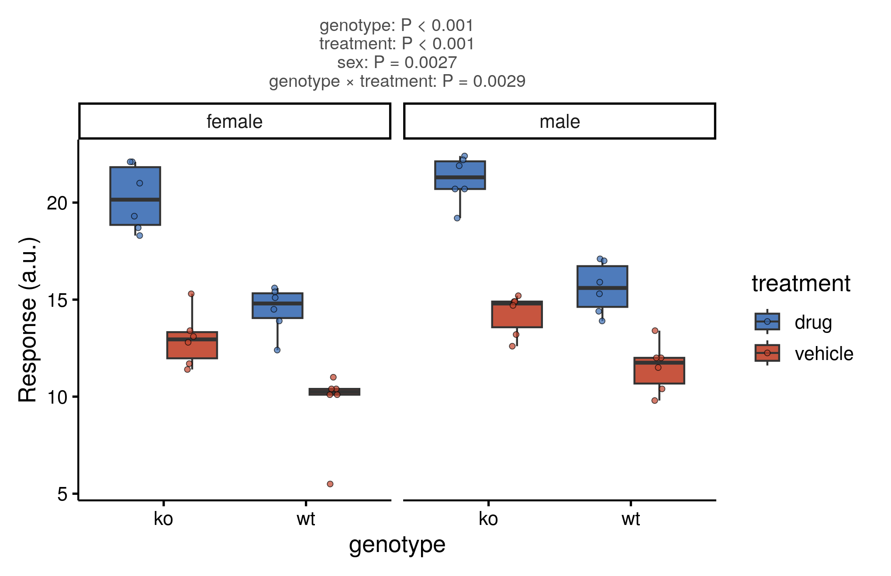

::: {.callout-important}
A manual command generated this report without an LLM model.
No separate human scientific review is part of this fixed recipe.
The report records the selected recipe and does not claim a new method.
:::

## Figure

## Statistical results

| effect | df1 | df2 | statistic | p_value | effect_size | effect_size_name | significant |
| --- | --- | --- | --- | --- | --- | --- | --- |
| genotype | 1 | 40 | 111.297033321827 | 4.03475468108602e-13 | 0.735619402960035 | partial eta squared | TRUE |
| treatment | 1 | 40 | 197.011899201982 | 4.80901048940054e-17 | 0.831232102123649 | partial eta squared | TRUE |
| sex | 1 | 40 | 10.202550409162 | 0.00273439730727323 | 0.20322773098197 | partial eta squared | TRUE |
| genotype:treatment | 1 | 40 | 10.0742177188458 | 0.00289012052954796 | 0.201185723467714 | partial eta squared | TRUE |
| genotype:sex | 1 | 40 | 0.243771194184417 | 0.624195816399933 | 0.00605736457968046 | partial eta squared | FALSE |
| treatment:sex | 1 | 40 | 0.511807825857418 | 0.478512679627639 | 0.0126335469416091 | partial eta squared | FALSE |
| genotype:treatment:sex | 1 | 40 | 0.0740146607915223 | 0.786978080308169 | 0.00184694898721835 | partial eta squared | FALSE |

## Methods

Response (a.u.) was analyzed by a 3-way ANOVA (Type II sums of squares) with factors genotype, treatment, sex. Effects tested: genotype (F(1, 40) = 111.30, P < 0.001); treatment (F(1, 40) = 197.01, P < 0.001); sex (F(1, 40) = 10.20, P = 0.0027); genotype x treatment (F(1, 40) = 10.07, P = 0.0029); genotype x sex (F(1, 40) = 0.24, P = 0.62); treatment x sex (F(1, 40) = 0.51, P = 0.48); genotype x treatment x sex (F(1, 40) = 0.07, P = 0.79). Effect sizes are partial eta squared. Significance was set at P < 0.05. Analyses were performed in R 4.4.1 with car 3.1.3; figures were produced with ggplot2 3.5.1.

## Plot configuration

The complete plot configuration is in `plot_config.yaml`.

## Provenance

| field | value |
| --- | --- |
| repository | pubready |
| repository_version | 1.0.0 |
| git_commit | 08e20b9ab068444757d8a4eefce4044219afc94d |
| git_dirty | FALSE |
| llm_provider | none |
| llm_model | none |
| agent_harness | manual |
| agent_harness_version | not_recorded |
| container_image | localhost/pubready:1.0.0 |
| container_digest | sha256:21946b0ae6b172f82e028cd57ac788e4b5b7161123799eebaf0ccc68dc590410 |
| input | {"file":"input_response.csv","md5":"b1ab1ae1731e3311d49a8727536cd99f","sha256":"b2267d6af2d2f49bbf1e1e75507c56dd8257334c80639c781f35701ca9ea67e8"} |
| command | figkit plot --recipe factorial_anova |
| analysis_options | {"engine":"r","recipe":"factorial_anova","data":{"file":"threeway_response.csv","x":"genotype","y":"response","fill":"treatment","facet":"sex","time":null,"event":null,"annotation":null,"id":null,"group":null,"label":null,"positive":null,"se":null,"ci_low":null,"ci_high":null,"measure":null,"ref":null,"cause":null,"levels":null,"markers":null,"covariates":null},"test":{"method":"auto","paired":false,"p_adjust":"none"},"appearance":{"theme":"pubready_house","palette":null,"x_label":null,"y_label":"Response (a.u.)","title":null,"y_limits":[null,null],"show_points":true,"geom":"box","bracket":{"show":true,"label":"p.signif"},"scale":"row","cluster":"both","fc_cutoff":1,"p_cutoff":0.05,"top_n":15,"pd_threshold":20,"pr_threshold":-30}} |
| random_seeds | not_applicable |
| session_record | session_info.txt |
| created_utc | 2026-07-18T00:00:00Z |
| review_state | not_applicable |
| reviewer | none |
| quarto_version | 1.11.4 |

The report source reads only files in this bundle.
