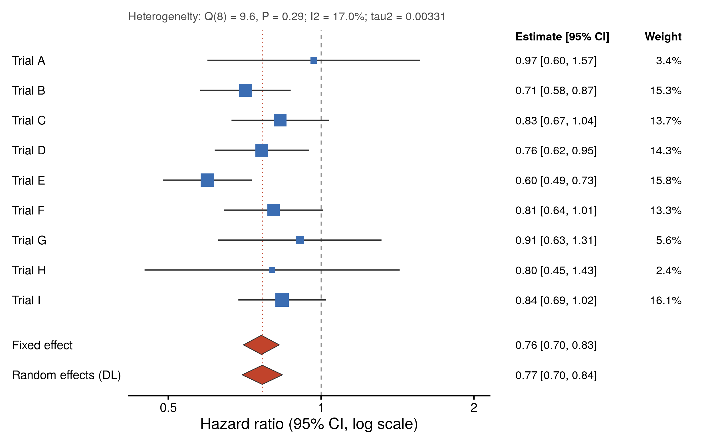

::: {.callout-important}
A manual command generated this report without an LLM model.
No separate human scientific review is part of this fixed recipe.
The report records the selected recipe and does not claim a new method.
:::

## Figure

## Statistical results

| row_type | label | estimate | ci_low | ci_high | yi | se | weight_fixed_pct | weight_random_pct | z | p_value | q | q_df | q_p | i2 | tau2 |
| --- | --- | --- | --- | --- | --- | --- | --- | --- | --- | --- | --- | --- | --- | --- | --- |
| study | Trial A | 0.968 | 0.597 | 1.568 | -0.0325231917055601 | 0.246341028492 | 2.85037112118722 | 3.41821798143789 |  |  |  |  |  |  |  |
| study | Trial B | 0.71 | 0.578 | 0.871 | -0.342490308946776 | 0.104611133524567 | 15.8058950507295 | 15.3484424270294 |  |  |  |  |  |  |  |
| study | Trial C | 0.831 | 0.666 | 1.036 | -0.185125484126689 | 0.112714507961411 | 13.6149255493513 | 13.6604124258743 |  |  |  |  |  |  |  |
| study | Trial D | 0.764 | 0.617 | 0.947 | -0.269187489815617 | 0.109295393349085 | 14.4800877941421 | 14.3402114425402 |  |  |  |  |  |  |  |
| study | Trial E | 0.597 | 0.488 | 0.73 | -0.515838165589535 | 0.102738910374365 | 16.3872092428075 | 15.7782357413417 |  |  |  |  |  |  |  |
| study | Trial F | 0.806 | 0.644 | 1.009 | -0.215671536475509 | 0.114547077852205 | 13.1827762420253 | 13.3141238639113 |  |  |  |  |  |  |  |
| study | Trial G | 0.908 | 0.627 | 1.315 | -0.0965109003808437 | 0.188943625959727 | 4.84518561148329 | 5.60756686558222 |  |  |  |  |  |  |  |
| study | Trial H | 0.801 | 0.449 | 1.428 | -0.221894331913778 | 0.295160335670349 | 1.98544983596266 | 2.41893208299515 |  |  |  |  |  |  |  |
| study | Trial I | 0.838 | 0.687 | 1.022 | -0.176737178500054 | 0.10132392270323 | 16.8480995523112 | 16.1138571692878 |  |  |  |  |  |  |  |
| pooled | Fixed effect | 0.762566518860223 | 0.702872222840633 | 0.82733059692764 | -0.271065536456098 | 0.0415898596642966 | 100 |  | -6.51758718697477 | 7.14472941581627e-11 | 9.64345262989938 | 8 | 0.290947659275638 | 17.0421600330558 | 0.00330800912023779 |
| pooled | Random effects (DerSimonian-Laird) | 0.765724295475695 | 0.698654055933635 | 0.83923322523078 | -0.266933101608445 | 0.046769466786191 |  | 100 | -5.70742238368341 | 1.14699896312483e-08 | 9.64345262989938 | 8 | 0.290947659275638 | 17.0421600330558 | 0.00330800912023779 |

## Methods

9 studies were pooled by inverse-variance weighting on the log scale and back-transformed, with the standard error of each study derived from its 95% confidence interval or given directly. The fixed-effect estimate of hazard_ratio was 0.763 (95% CI 0.703 to 0.827, P = 7.1e-11), and the DerSimonian-Laird random-effects estimate was 0.766 (95% CI 0.699 to 0.839, P = 1.1e-08). Heterogeneity was assessed with Cochran's Q (Q = 9.64, df = 8, P = 0.29), I2 = 17.0% and tau2 = 0.0033. Squares are sized by the random-effects weight and the diamonds show the pooled estimates. Computed in R 4.4.1 with metafor 4.6.0 and drawn with ggplot2 3.5.1.

## Plot configuration

The complete plot configuration is in `plot_config.yaml`.

## Provenance

| field | value |
| --- | --- |
| repository | pubready |
| repository_version | 0.4.1 |
| git_commit | f82215f4b833c9d70432f64150af9bc357a8d5e4 |
| git_dirty | FALSE |
| llm_provider | none |
| llm_model | none |
| agent_harness | manual |
| agent_harness_version | not_recorded |
| container_image | localhost/pubready:0.4.1 |
| container_digest | sha256:339bf57d4f33cf35d6ffa492d0e2faccd3ab5e0a435e20512b201d2c5fffd9e4 |
| input | {"file":"input_hazard_ratio.csv","md5":"24320e4211da4db9bf76c9a1fedeb1e9","sha256":"01b10b5db2fbcdca95bb708eb109ab543a00c92557e91fbc44d75ad98d46acc6"} |
| command | figkit plot --recipe forest_meta |
| analysis_options | {"engine":"r","recipe":"forest_meta","data":{"file":"meta_trials.csv","x":"Hazard ratio (95% CI, log scale)","y":"hazard_ratio","fill":null,"facet":null,"time":null,"event":null,"annotation":null,"id":null,"group":null,"label":"trial","positive":null,"se":null,"ci_low":"ci_low","ci_high":"ci_high","measure":null,"markers":null,"covariates":null},"test":{"method":"auto","paired":false,"p_adjust":"none"},"appearance":{"theme":"pubready_house","palette":null,"x_label":"Hazard ratio (95% CI, log scale)","y_label":null,"title":null,"y_limits":[null,null],"show_points":true,"geom":"box","bracket":{"show":true,"label":"p.signif"},"scale":"row","cluster":"both","fc_cutoff":1,"p_cutoff":0.05,"top_n":15,"pd_threshold":20,"pr_threshold":-30}} |
| random_seeds | not_applicable |
| session_record | session_info.txt |
| created_utc | 2026-07-18T00:00:00Z |
| review_state | not_applicable |
| reviewer | none |
| quarto_version | 1.11.4 |

The report source reads only files in this bundle.
