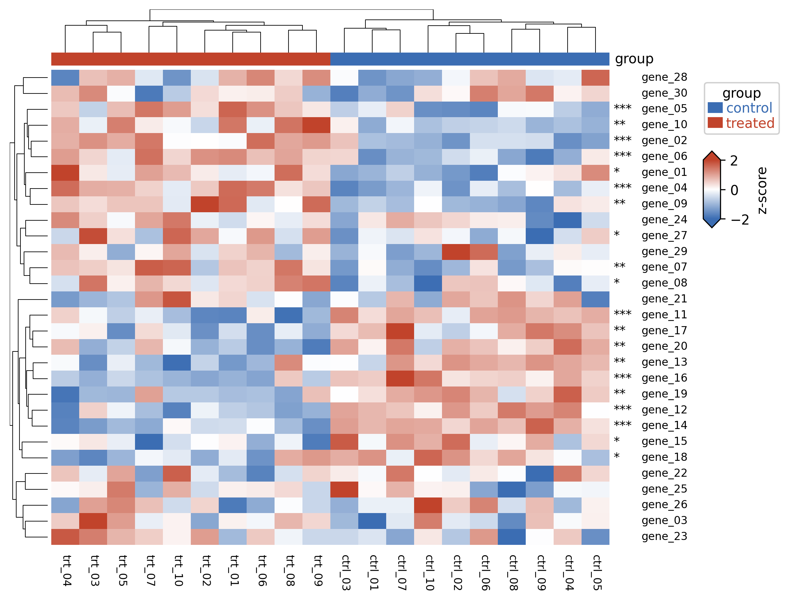

::: {.callout-important}
A manual command generated this report without an LLM model.
No separate human scientific review is part of this fixed recipe.
The report records the selected recipe and does not claim a new statistical method.
:::

## Figure

## Statistical results

| feature | mean_control | mean_treated | p_value | p_adj | significant |
| --- | --- | --- | --- | --- | --- |
| gene_01 | 8.068000000000001 | 10.299 | 0.010355518571379972 | 0.01725919761896662 | True |
| gene_02 | 8.200000000000001 | 11.867 | 2.4875183967825696e-05 | 0.00014925110380695417 | True |
| gene_03 | 8.884 | 10.171000000000001 | 0.1049647292254058 | 0.1431337216710079 | False |
| gene_04 | 7.513000000000001 | 11.925 | 1.261016001836405e-05 | 0.00014925110380695417 | True |
| gene_05 | 8.675999999999998 | 11.971000000000002 | 0.00023521118853473636 | 0.0008820419570052614 | True |
| gene_06 | 8.14 | 11.209999999999999 | 6.0813190272566293e-05 | 0.00030406595136283146 | True |
| gene_07 | 8.366 | 11.390999999999998 | 0.0005375294755388673 | 0.0017917649184628912 | True |
| gene_08 | 8.299999999999999 | 10.278000000000002 | 0.006977648612901074 | 0.013083091149189515 | True |
| gene_09 | 7.753 | 11.042 | 0.0006355923467152605 | 0.0019067770401457816 | True |
| gene_10 | 7.459999999999999 | 10.122 | 0.001816234879882795 | 0.003891931885463132 | True |
| gene_11 | 7.5329999999999995 | 4.523000000000001 | 0.0002153555588430799 | 0.0008820419570052614 | True |
| gene_12 | 7.527999999999999 | 4.941 | 2.374573470820789e-05 | 0.00014925110380695417 | True |
| gene_13 | 8.312000000000001 | 5.502999999999998 | 0.0017124764327323238 | 0.003891931885463132 | True |
| gene_14 | 7.867999999999999 | 3.121 | 1.7416706285703117e-06 | 5.225011885710935e-05 | True |
| gene_15 | 7.481999999999999 | 5.429 | 0.00893932557680318 | 0.01577528042965267 | True |
| gene_16 | 8.565999999999999 | 5.122999999999999 | 2.2877538286306074e-05 | 0.00014925110380695417 | True |
| gene_17 | 7.4799999999999995 | 4.747999999999999 | 0.0021355230162193916 | 0.004271046032438783 | True |
| gene_18 | 7.882 | 5.388 | 0.013510867976726435 | 0.021332949436936477 | True |
| gene_19 | 7.81 | 5.048 | 0.001039462659524448 | 0.002834898162339404 | True |
| gene_20 | 7.984000000000002 | 5.5280000000000005 | 0.0015101137516669169 | 0.003775284379167292 | True |
| gene_21 | 8.118 | 7.803 | 0.6068266594475775 | 0.6585089868767342 | False |
| gene_22 | 8.318000000000001 | 7.9350000000000005 | 0.6146083877516186 | 0.6585089868767342 | False |
| gene_23 | 7.208999999999999 | 8.517999999999999 | 0.037440660586922435 | 0.05348665798131777 | False |
| gene_24 | 7.737 | 8.652999999999999 | 0.11645648513668602 | 0.15189976322176438 | False |
| gene_25 | 7.850999999999999 | 8.171999999999999 | 0.6128215422003347 | 0.6585089868767342 | False |
| gene_26 | 8.421000000000001 | 8.033000000000001 | 0.4209488195680372 | 0.5261860244600465 | False |
| gene_27 | 7.300999999999999 | 8.53 | 0.02131672454467036 | 0.03197508681700554 | True |
| gene_28 | 8.64 | 9.018 | 0.5491062333647438 | 0.6585089868767342 | False |
| gene_29 | 7.660999999999999 | 7.848999999999999 | 0.6848573607367963 | 0.7084731317966858 | False |
| gene_30 | 8.041 | 7.9430000000000005 | 0.8710922590752872 | 0.8710922590752872 | False |

## Methods

A heatmap of 30 features across 20 samples was drawn with PyComplexHeatmap. Values were z-scored across samples within each feature (row scaling). Rows and columns were hierarchically clustered. A per-feature Welch t-test (control vs treated), BH-adjusted was applied per feature; 20 feature(s) were significant (adjusted P < 0.05). Rendered in Python 3.10.12 with PyComplexHeatmap 1.8.5.

## Plot configuration

The complete plot configuration is in `plot_config.yaml`.

## Provenance

| field | value |
| --- | --- |
| repository | pubready |
| repository_version | 0.4.1 |
| git_commit | e8f923bef415cd1719ad862c56f1043770302fc8 |
| git_dirty | False |
| llm_provider | none |
| llm_model | none |
| agent_harness | manual |
| agent_harness_version | not_recorded |
| container_image | localhost/pubready:0.4.1 |
| container_digest | sha256:097c136b375dd40cd790ef1528d70d748ab67d06fc44e73c70de82b4a4782d17 |
| input | {"file": "input_expression_matrix.csv", "md5": "ca9f8a5e682388268ffb561ea779a536", "sha256": "88a6c73257c7a2c3c3f481165584f21cb60cc907778508e023fb2762472198f4"} |
| command | figkit plot --recipe heatmap |
| analysis_options | {"engine": "python", "recipe": "heatmap", "data": {"file": "expression_matrix.csv", "x": null, "y": null, "fill": null, "facet": null, "time": null, "event": null, "annotation": "example/expression_annotation.csv", "covariates": null, "id": null, "group": null, "label": null, "positive": null, "se": null, "ci_low": null, "ci_high": null, "measure": null, "markers": null}, "test": {"method": "auto", "paired": false, "p_adjust": "none"}, "appearance": {"theme": "pubready_house", "palette": null, "x_label": null, "y_label": null, "title": null, "y_limits": [null, null], "show_points": true, "geom": "box", "bracket": {"show": true, "label": "p.signif"}, "scale": "row", "cluster": "both", "fc_cutoff": 1.0, "p_cutoff": 0.05, "top_n": 15, "pd_threshold": 20.0, "pr_threshold": -30.0}} |
| random_seeds | not_applicable |
| session_record | session_info.txt |
| created_utc | 2026-07-18T00:00:00Z |
| review_state | not_applicable |
| reviewer | none |
| quarto_version | 1.11.4 |

The report source reads only files in this bundle.
