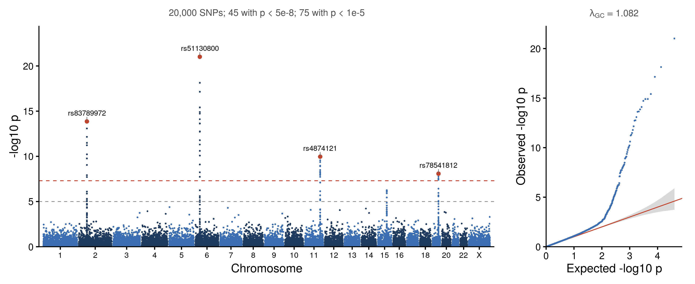

::: {.callout-important}
A manual command generated this report without an LLM model.
No separate human scientific review is part of this fixed recipe.
The report records the selected recipe and does not claim a new method.
:::

## Figure

## Statistical results

| row_type | chr | snp | pos | p_value | n_snps | lambda_gc | n_genome_wide | n_suggestive |
| --- | --- | --- | --- | --- | --- | --- | --- | --- |
| genome |  |  |  | 9.607e-22 | 20000 | 1.08165031666491 | 45 | 75 |
| lead | 6 | rs51130800 | 32609459 | 9.607e-22 |  |  |  |  |
| lead | 2 | rs83789972 | 60102138 | 1.376e-14 |  |  |  |  |
| lead | 11 | rs4874121 | 113391019 | 1.089e-10 |  |  |  |  |
| lead | 19 | rs78541812 | 44888209 | 8.288e-09 |  |  |  |  |

## Methods

Association results for 20,000 SNPs on 23 chromosomes were shown as a Manhattan plot of -log10 p at the cumulative genomic position, with the genome-wide significance line at p = 5e-8 and the suggestive line at p = 1e-5. 45 SNPs reached genome-wide significance and 75 passed the suggestive line (smallest p = 9.61e-22); the lead SNP of each chromosome with p < 5e-8 is labelled (4 shown). The QQ plot compares the observed -log10 p with the expected uniform quantiles, (i - 0.5) / n, with a 95% band from the Beta(i, n - i + 1) distribution of the order statistics. The genomic inflation factor was lambda_GC = 1.082, the median of the 1-df chi-square statistics over its expected value of 0.455. All 20,000 SNPs are drawn in the Manhattan panel. The QQ panel draws every SNP with p < 0.01 and, for the others, one point per 0.005 by 0.005 cell of -log10 p, because the sorted points lie on one curve. The association test itself was performed upstream; this figure summarises its output. Drawn in R 4.4.1 with ggplot2 3.5.1, ggrepel 0.9.6 and ggpubr 0.6.0.

## Plot configuration

The complete plot configuration is in `plot_config.yaml`.

## Provenance

| field | value |
| --- | --- |
| repository | pubready |
| repository_version | 1.0.0 |
| git_commit | 31d6bbe65e2043a4e8204e63902cf8f8a135acf6 |
| git_dirty | FALSE |
| llm_provider | none |
| llm_model | none |
| agent_harness | manual |
| agent_harness_version | not_recorded |
| container_image | localhost/pubready:1.0.0 |
| container_digest | sha256:21946b0ae6b172f82e028cd57ac788e4b5b7161123799eebaf0ccc68dc590410 |
| input | {"file":"input_gwas_summary.csv","md5":"cbcaf85e088a7d1bb7bb44fd15648588","sha256":"40a04af482fa40bdc75f42613110744366fc3a2eb9cb5e029968fe29869c58a4"} |
| command | figkit plot --recipe manhattan |
| analysis_options | {"engine":"r","recipe":"manhattan","data":{"file":"gwas_summary.csv","x":"pos","y":"p","fill":null,"facet":null,"time":null,"event":null,"annotation":null,"id":null,"group":"chr","label":"snp","positive":null,"se":null,"ci_low":null,"ci_high":null,"measure":null,"ref":null,"cause":null,"levels":null,"markers":null,"covariates":null},"test":{"method":"auto","paired":false,"p_adjust":"none"},"appearance":{"theme":"pubready_house","palette":null,"x_label":null,"y_label":null,"title":null,"y_limits":[null,null],"show_points":true,"geom":"box","bracket":{"show":true,"label":"p.signif"},"scale":"row","cluster":"both","fc_cutoff":1,"p_cutoff":0.05,"top_n":15,"pd_threshold":20,"pr_threshold":-30}} |
| random_seeds | not_applicable |
| session_record | session_info.txt |
| created_utc | 2026-07-18T00:00:00Z |
| review_state | not_applicable |
| reviewer | none |
| quarto_version | 1.11.4 |

The report source reads only files in this bundle.
