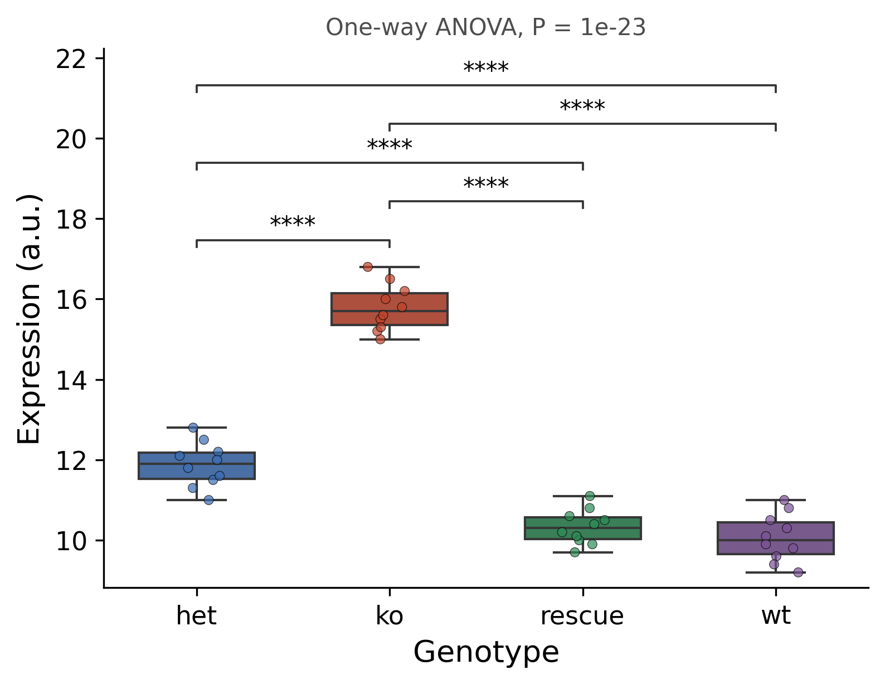

::: {.callout-important}
A manual command generated this report without an LLM model.
No separate human scientific review is part of this fixed recipe.
The report records the selected recipe and does not claim a new statistical method.
:::

## Figure

## Statistical results

| outcome | group1 | group2 | contrast | n1 | n2 | post_hoc | estimate | p_adj | p_adj_signif | displayed | omnibus_test | omnibus_statistic | omnibus_df1 | omnibus_df2 | omnibus_p | omnibus_effect_size_name | omnibus_effect_size |
| --- | --- | --- | --- | --- | --- | --- | --- | --- | --- | --- | --- | --- | --- | --- | --- | --- | --- |
| expression | het | ko | ko - het | 10 | 10 | Tukey's HSD | 3.910000000000002 | 4.9960036108132044e-15 | **** | True | one-way ANOVA | 235.83211267605637 | 3 | 36 | 1.0214193694811828e-23 | partial eta-squared | 0.9515801246641298 |
| expression | het | rescue | rescue - het | 10 | 10 | Tukey's HSD | -1.549999999999999 | 1.2967871768632122e-06 | **** | True | one-way ANOVA | 235.83211267605637 | 3 | 36 | 1.0214193694811828e-23 | partial eta-squared | 0.9515801246641298 |
| expression | het | wt | wt - het | 10 | 10 | Tukey's HSD | -1.8200000000000003 | 4.561359057131398e-08 | **** | True | one-way ANOVA | 235.83211267605637 | 3 | 36 | 1.0214193694811828e-23 | partial eta-squared | 0.9515801246641298 |
| expression | ko | rescue | rescue - ko | 10 | 10 | Tukey's HSD | -5.460000000000001 | 4.884981308350689e-15 | **** | True | one-way ANOVA | 235.83211267605637 | 3 | 36 | 1.0214193694811828e-23 | partial eta-squared | 0.9515801246641298 |
| expression | ko | wt | wt - ko | 10 | 10 | Tukey's HSD | -5.730000000000002 | 4.884981308350689e-15 | **** | True | one-way ANOVA | 235.83211267605637 | 3 | 36 | 1.0214193694811828e-23 | partial eta-squared | 0.9515801246641298 |
| expression | rescue | wt | wt - rescue | 10 | 10 | Tukey's HSD | -0.27000000000000135 | 0.6857947897299388 | ns | False | one-way ANOVA | 235.83211267605637 | 3 | 36 | 1.0214193694811828e-23 | partial eta-squared | 0.9515801246641298 |

## Methods

Expression (a.u.) was compared across 4 groups with a one-way ANOVA (F(3, 36) = 235.83, P = 1e-23). The effect size was partial eta-squared = 0.95. Pairwise comparisons used Tukey's HSD; only comparisons reaching significance (adjusted P < 0.05) are annotated on the figure with brackets. Analyses were performed in Python 3.10.12 with pingouin 0.6.1 and scikit-posthocs 0.17.1; figures were produced with seaborn 0.13.2. Group sizes: het (n = 10), ko (n = 10), rescue (n = 10), wt (n = 10).

## Plot configuration

The complete plot configuration is in `plot_config.yaml`.

## Provenance

| field | value |
| --- | --- |
| repository | pubready |
| repository_version | 3.0.0 |
| git_commit | 4657df8148b43cbd66ec3a2bc04a756a38e7843c |
| git_dirty | False |
| llm_provider | none |
| llm_model | none |
| agent_harness | manual |
| agent_harness_version | not_recorded |
| container_image | localhost/pubready:3.0.0 |
| container_digest | sha256:6af675049bd5433b2d94050941a2f5aaa8644e1656f74e21f139a93e36308290 |
| input | {"file": "input_expression.csv", "md5": "55d3ddd6425019751d19883d1fe81771", "sha256": "0d5ab7e477ae444212d4b0eebf041038d659bee75d425c1cd51401dcd73d034b"} |
| command | figkit plot --recipe multi_group_compare |
| analysis_options | {"engine": "python", "recipe": "multi_group_compare", "data": {"file": "gene_expression.csv", "x": "genotype", "y": "expression", "fill": null, "facet": null, "time": null, "event": null, "annotation": null, "covariates": null, "id": null, "group": null, "label": null, "positive": null, "se": null, "ci_low": null, "ci_high": null, "measure": null, "ref": null, "cause": null, "levels": null, "markers": null}, "test": {"method": "auto", "paired": false, "p_adjust": "none"}, "appearance": {"theme": "pubready_house", "palette": null, "x_label": "Genotype", "y_label": "Expression (a.u.)", "title": null, "y_limits": [null, null], "show_points": true, "geom": "box", "bracket": {"show": true, "label": "p.signif"}, "scale": "row", "cluster": "both", "fc_cutoff": 1.0, "p_cutoff": 0.05, "top_n": 15, "pd_threshold": 20.0, "pr_threshold": -30.0}} |
| random_seeds | not_applicable |
| session_record | session_info.txt |
| created_utc | 2026-07-18T00:00:00Z |
| review_state | not_applicable |
| reviewer | none |
| quarto_version | 1.11.4 |

The report source reads only files in this bundle.
