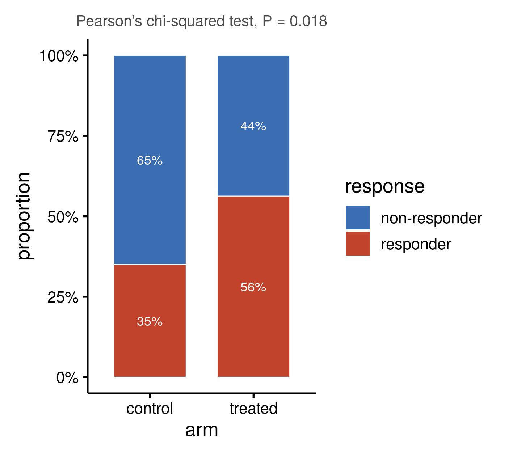

::: {.callout-important}
A manual command generated this report without an LLM model.
No separate human scientific review is part of this fixed recipe.
The report records the selected recipe and does not claim a new method.
:::

## Figure

## Statistical results

| group | outcome | n | proportion |
| --- | --- | --- | --- |
| control | non-responder | 39 | 0.65 |
| treated | non-responder | 28 | 0.4375 |
| control | responder | 21 | 0.35 |
| treated | responder | 36 | 0.5625 |

## Methods

The distribution of the outcome (2 categories) across 2 groups (n = 124) was tested with Pearson's chi-squared test (P = 0.018). The odds ratio was 2.39. Proportions are shown as a 100% stacked bar per group. Drawn in R 4.4.1 with ggplot2 3.5.1.

## Plot configuration

The complete plot configuration is in `plot_config.yaml`.

## Provenance

| field | value |
| --- | --- |
| repository | pubready |
| repository_version | 2.0.0 |
| git_commit | 1b8bb2fd31d9315d60137be3bc664c2a3e33f671 |
| git_dirty | FALSE |
| llm_provider | none |
| llm_model | none |
| agent_harness | manual |
| agent_harness_version | not_recorded |
| container_image | localhost/pubready:2.0.0 |
| container_digest | sha256:f22d119d4121702c30e3632421cdf83f9bc1b190c13c3547876874aed2f0419e |
| input | {"file":"input_response.csv","md5":"b8a5c64645d67aefe9af72a0c3d14d2b","sha256":"89ccd79ae898130f014ac13653961046651fd52eecc5b901d8ab858f1e90df36"} |
| command | figkit plot --recipe proportions |
| analysis_options | {"engine":"r","recipe":"proportions","data":{"file":"response_by_arm.csv","x":"arm","y":"response","fill":null,"facet":null,"time":null,"event":null,"annotation":null,"id":null,"group":null,"label":null,"positive":null,"se":null,"ci_low":null,"ci_high":null,"measure":null,"ref":null,"cause":null,"levels":null,"markers":null,"covariates":null},"test":{"method":"auto","paired":false,"p_adjust":"none"},"appearance":{"theme":"pubready_house","palette":null,"x_label":null,"y_label":null,"title":null,"y_limits":[null,null],"show_points":true,"geom":"box","bracket":{"show":true,"label":"p.signif"},"scale":"row","cluster":"both","fc_cutoff":1,"p_cutoff":0.05,"top_n":15,"pd_threshold":20,"pr_threshold":-30}} |
| random_seeds | not_applicable |
| session_record | session_info.txt |
| created_utc | 2026-07-18T00:00:00Z |
| review_state | not_applicable |
| reviewer | none |
| quarto_version | 1.11.4 |

The report source reads only files in this bundle.
