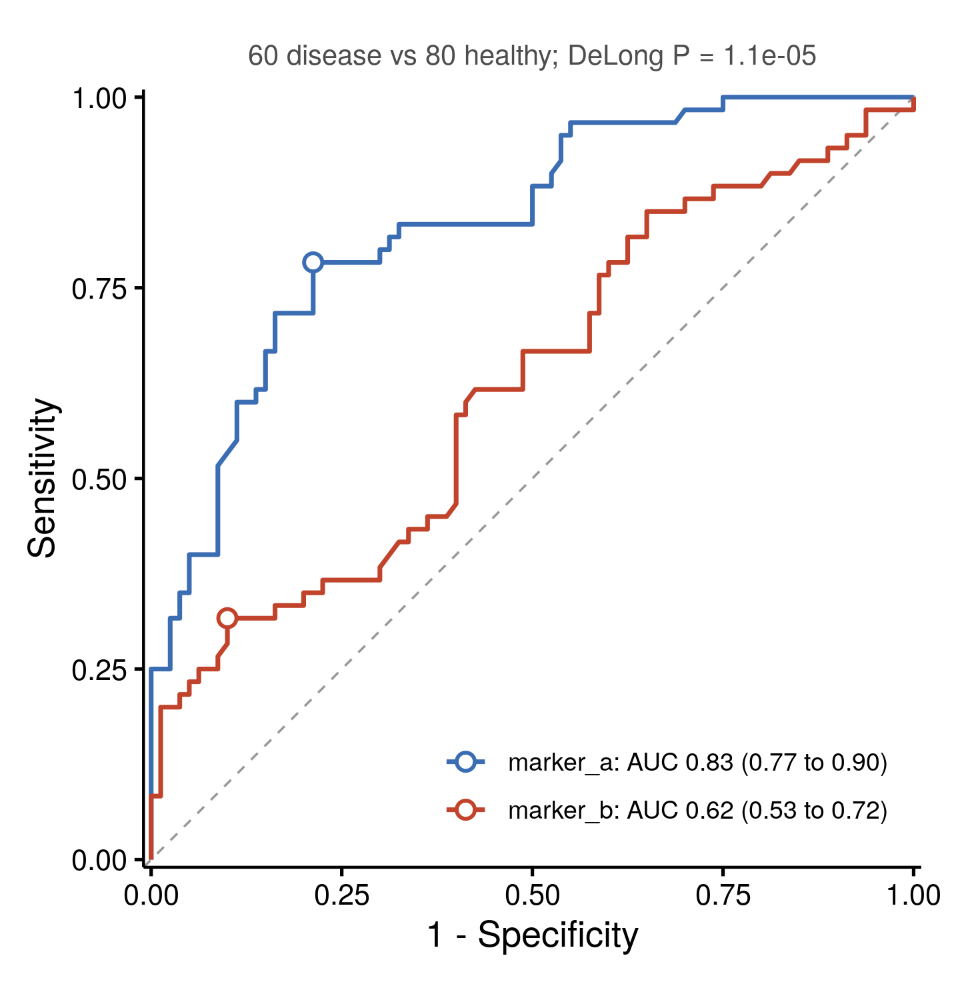

::: {.callout-important}
A manual command generated this report without an LLM model.
No separate human scientific review is part of this fixed recipe.
The report records the selected recipe and does not claim a new method.
:::

## Figure

## Statistical results

| marker | case_level | n_cases | n_controls | direction | auc | auc_ci_low | auc_ci_high | youden_threshold | sensitivity | specificity | delong_z_vs_first | delong_p_vs_first |
| --- | --- | --- | --- | --- | --- | --- | --- | --- | --- | --- | --- | --- |
| marker_a | disease | 60 | 80 | < | 0.833958333333333 | 0.767585790501013 | 0.900330876165654 | 3.975 | 0.783333333333333 | 0.7875 |  |  |
| marker_b | disease | 60 | 80 | < | 0.621354166666667 | 0.52666517609812 | 0.716043157235213 | 10.835 | 0.316666666666667 | 0.9 | 4.40429674134525 | 1.06127592072159e-05 |

## Methods

Receiver operating characteristic (ROC) curves were computed for the discrimination of status = disease (cases, n = 60) from healthy (controls, n = 80). The area under each curve (AUC) is reported with a 95% confidence interval by the method of DeLong et al. (1988), and the optimal threshold maximises the Youden index (sensitivity + specificity - 1). marker_a, AUC = 0.834 (95% CI 0.768 to 0.900), optimal threshold 3.975 (sensitivity 0.78, specificity 0.79); marker_b, AUC = 0.621 (95% CI 0.527 to 0.716), optimal threshold 10.84 (sensitivity 0.32, specificity 0.90). The AUC of each marker was compared with that of marker_a by DeLong's test for two correlated ROC curves: marker_b, Z = 4.40, P = 1.1e-05. Computed in R 4.4.1 with pROC 1.18.5 and drawn with ggplot2 3.5.1.

## Plot configuration

The complete plot configuration is in `plot_config.yaml`.

## Provenance

| field | value |
| --- | --- |
| repository | pubready |
| repository_version | 1.0.0 |
| git_commit | 31d6bbe65e2043a4e8204e63902cf8f8a135acf6 |
| git_dirty | FALSE |
| llm_provider | none |
| llm_model | none |
| agent_harness | manual |
| agent_harness_version | not_recorded |
| container_image | localhost/pubready:1.0.0 |
| container_digest | sha256:21946b0ae6b172f82e028cd57ac788e4b5b7161123799eebaf0ccc68dc590410 |
| input | {"file":"input_status_marker_a_marker_b.csv","md5":"f6d3a1a52479ba12f8a4ee2644beb33d","sha256":"093cd3826f05f33eb5db7e8f7d1b571a2e2c02a398727171a5702f39ecce3fa7"} |
| command | figkit plot --recipe roc_curve |
| analysis_options | {"engine":"r","recipe":"roc_curve","data":{"file":"biomarker_roc.csv","x":"marker_a,marker_b","y":"status","fill":null,"facet":null,"time":null,"event":null,"annotation":null,"id":null,"group":null,"label":null,"positive":"disease","se":null,"ci_low":null,"ci_high":null,"measure":null,"ref":null,"cause":null,"levels":null,"markers":null,"covariates":null},"test":{"method":"auto","paired":false,"p_adjust":"none"},"appearance":{"theme":"pubready_house","palette":null,"x_label":null,"y_label":null,"title":null,"y_limits":[null,null],"show_points":true,"geom":"box","bracket":{"show":true,"label":"p.signif"},"scale":"row","cluster":"both","fc_cutoff":1,"p_cutoff":0.05,"top_n":15,"pd_threshold":20,"pr_threshold":-30}} |
| random_seeds | not_applicable |
| session_record | session_info.txt |
| created_utc | 2026-07-18T00:00:00Z |
| review_state | not_applicable |
| reviewer | none |
| quarto_version | 1.11.4 |

The report source reads only files in this bundle.
