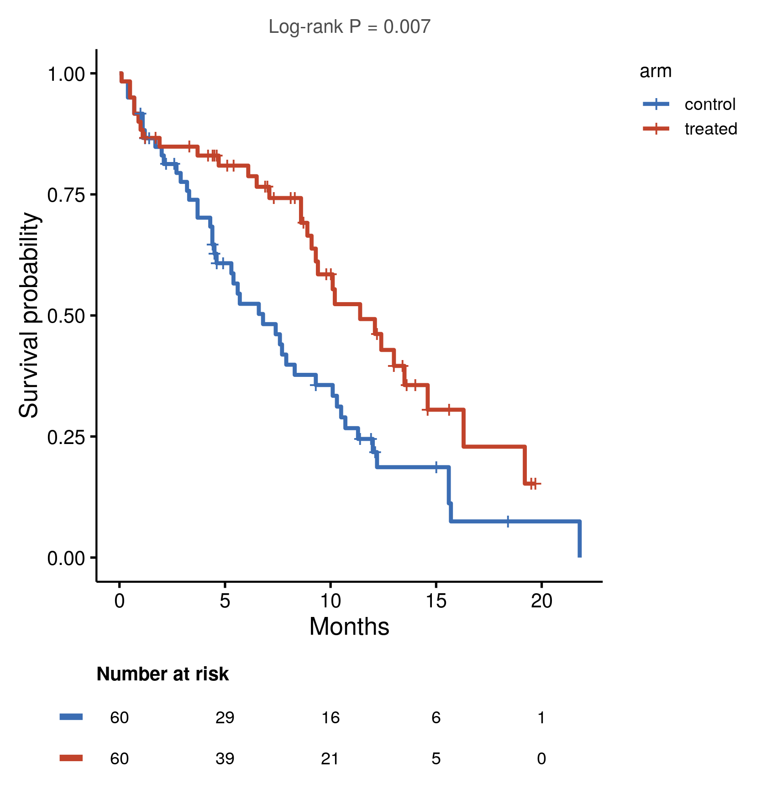

::: {.callout-important}
A manual command generated this report without an LLM model.
No separate human scientific review is part of this fixed recipe.
The report records the selected recipe and does not claim a new method.
:::

## Figure

## Statistical results

| group | n | events | median_survival | ci_low | ci_high | log_rank_p |
| --- | --- | --- | --- | --- | --- | --- |
| control | 60 | 45 | 6.8 | 4.6 | 10.1 | 0.00700203369548444 |
| treated | 60 | 30 | 11.4 | 9.3 | 19.2 | 0.00700203369548444 |

## Methods

Survival was estimated by the Kaplan-Meier method and compared between groups of arm with the log-rank test (chi-square(1) = 7.27, P = 0.007). Median survival by group: control (median  6.8), treated (median 11.4). Censoring is marked with ticks and the number at risk is tabulated below the curves. Analyses were performed in R 4.4.1 with survival 3.6.4 and survminer 0.4.9.

## Plot configuration

The complete plot configuration is in `plot_config.yaml`.

## Provenance

| field | value |
| --- | --- |
| repository | pubready |
| repository_version | 1.0.0 |
| git_commit | f66e11ade8775d5c33ce81c38926927708b194cb |
| git_dirty | TRUE |
| llm_provider | none |
| llm_model | none |
| agent_harness | manual |
| agent_harness_version | not_recorded |
| container_image | localhost/pubready:1.0.0 |
| container_digest | sha256:4aad0f46de6f65d943f66f6dd38001a64036986b3ec44c955a52a594a496fb6e |
| input | {"file":"input_arm.csv","md5":"6f53a662fffe08afdcf72fe041adaf29","sha256":"17dccfaf72c84d69607aa73efad89ed98d9af94e72ddd285bc864fa65346b75e"} |
| command | figkit plot --recipe survival_km |
| analysis_options | {"engine":"r","recipe":"survival_km","data":{"file":"survival_trial.csv","x":"arm","y":null,"fill":null,"facet":null,"time":"time","event":"event","annotation":null,"id":null,"group":null,"label":null,"positive":null,"se":null,"ci_low":null,"ci_high":null,"measure":null,"markers":null,"covariates":null},"test":{"method":"auto","paired":false,"p_adjust":"none"},"appearance":{"theme":"pubready_house","palette":null,"x_label":"Months","y_label":null,"title":null,"y_limits":[null,null],"show_points":true,"geom":"box","bracket":{"show":true,"label":"p.signif"},"scale":"row","cluster":"both","fc_cutoff":1,"p_cutoff":0.05,"top_n":15,"pd_threshold":20,"pr_threshold":-30}} |
| random_seeds | not_applicable |
| session_record | session_info.txt |
| created_utc | 2026-07-18T00:00:00Z |
| review_state | not_applicable |
| reviewer | none |
| quarto_version | 1.11.4 |

The report source reads only files in this bundle.
