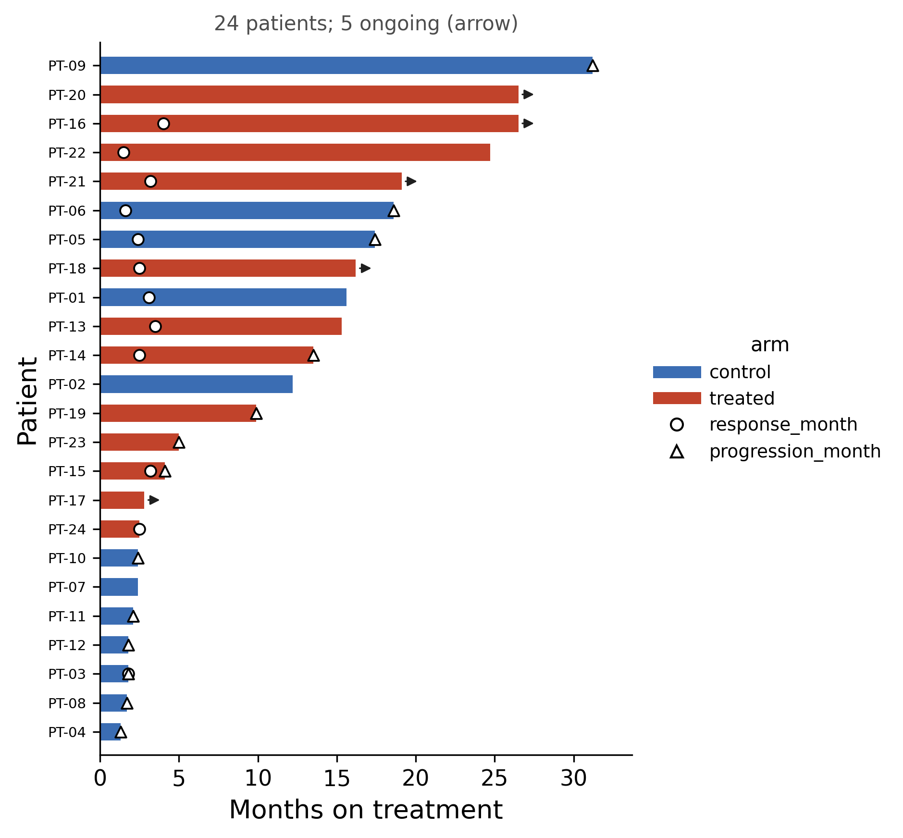

::: {.callout-important}
A manual command generated this report without an LLM model.
No separate human scientific review is part of this fixed recipe.
The report records the selected recipe and does not claim a new statistical method.
:::

## Figure

## Statistical results

| patient | group | duration | ongoing | response_month | progression_month |
| --- | --- | --- | --- | --- | --- |
| PT-09 | control | 31.2 | False | nan | 31.2 |
| PT-20 | treated | 26.5 | True | nan | nan |
| PT-16 | treated | 26.5 | True | 4.0 | nan |
| PT-22 | treated | 24.7 | False | 1.5 | nan |
| PT-21 | treated | 19.1 | True | 3.2 | nan |
| PT-06 | control | 18.6 | False | 1.6 | 18.6 |
| PT-05 | control | 17.4 | False | 2.4 | 17.4 |
| PT-18 | treated | 16.2 | True | 2.5 | nan |
| PT-01 | control | 15.6 | False | 3.1 | nan |
| PT-13 | treated | 15.3 | False | 3.5 | nan |
| PT-14 | treated | 13.5 | False | 2.5 | 13.5 |
| PT-02 | control | 12.2 | False | nan | nan |
| PT-19 | treated | 9.9 | False | nan | 9.9 |
| PT-23 | treated | 5.0 | False | nan | 5.0 |
| PT-15 | treated | 4.1 | False | 3.2 | 4.1 |
| PT-17 | treated | 2.8 | True | nan | nan |
| PT-24 | treated | 2.5 | False | 2.5 | nan |
| PT-10 | control | 2.4 | False | nan | 2.4 |
| PT-07 | control | 2.4 | False | nan | nan |
| PT-11 | control | 2.1 | False | nan | 2.1 |
| PT-12 | control | 1.8 | False | nan | 1.8 |
| PT-03 | control | 1.8 | False | 1.8 | 1.8 |
| PT-08 | control | 1.7 | False | nan | 1.7 |
| PT-04 | control | 1.3 | False | nan | 1.3 |

## Methods

Each of the 24 patients is drawn as one horizontal bar whose length is the value of months, sorted from the longest course at the top. An arrow marks a course that was ongoing at the data cut-off. Symbols mark response_month (12 patient(s)), progression_month (13 patient(s)). control: 12 patient(s), median duration 2.4, 0 ongoing; treated: 12 patient(s), median duration 14.4, 5 ongoing. The figure is descriptive, so no statistical test is applied. Drawn in Python 3.10.12 with matplotlib 3.10.9.

## Plot configuration

The complete plot configuration is in `plot_config.yaml`.

## Provenance

| field | value |
| --- | --- |
| repository | pubready |
| repository_version | 2.0.0 |
| git_commit | a9f218358c74881d725e4bdcd4c40be832ba06c8 |
| git_dirty | False |
| llm_provider | none |
| llm_model | none |
| agent_harness | manual |
| agent_harness_version | not_recorded |
| container_image | localhost/pubready:2.0.0 |
| container_digest | sha256:f22d119d4121702c30e3632421cdf83f9bc1b190c13c3547876874aed2f0419e |
| input | {"file": "input_months.csv", "md5": "b8d75bab35e8ca31ee1a4ca5fc089e74", "sha256": "94541cad1fc2ff7d0c412a3c79ef9f5b9a7fd2544a87bf360389f987e24dbe36"} |
| command | figkit plot --recipe swimmer |
| analysis_options | {"engine": "python", "recipe": "swimmer", "data": {"file": "swimmer_patients.csv", "x": null, "y": null, "fill": null, "facet": null, "time": "months", "event": "ended", "annotation": null, "covariates": null, "id": "patient", "group": "arm", "label": null, "positive": null, "se": null, "ci_low": null, "ci_high": null, "measure": null, "ref": null, "cause": null, "levels": null, "markers": ["response_month", "progression_month"]}, "test": {"method": "auto", "paired": false, "p_adjust": "none"}, "appearance": {"theme": "pubready_house", "palette": null, "x_label": "Months on treatment", "y_label": null, "title": null, "y_limits": [null, null], "show_points": true, "geom": "box", "bracket": {"show": true, "label": "p.signif"}, "scale": "row", "cluster": "both", "fc_cutoff": 1.0, "p_cutoff": 0.05, "top_n": 15, "pd_threshold": 20.0, "pr_threshold": -30.0}} |
| random_seeds | not_applicable |
| session_record | session_info.txt |
| created_utc | 2026-07-18T00:00:00Z |
| review_state | not_applicable |
| reviewer | none |
| quarto_version | 1.11.4 |

The report source reads only files in this bundle.
