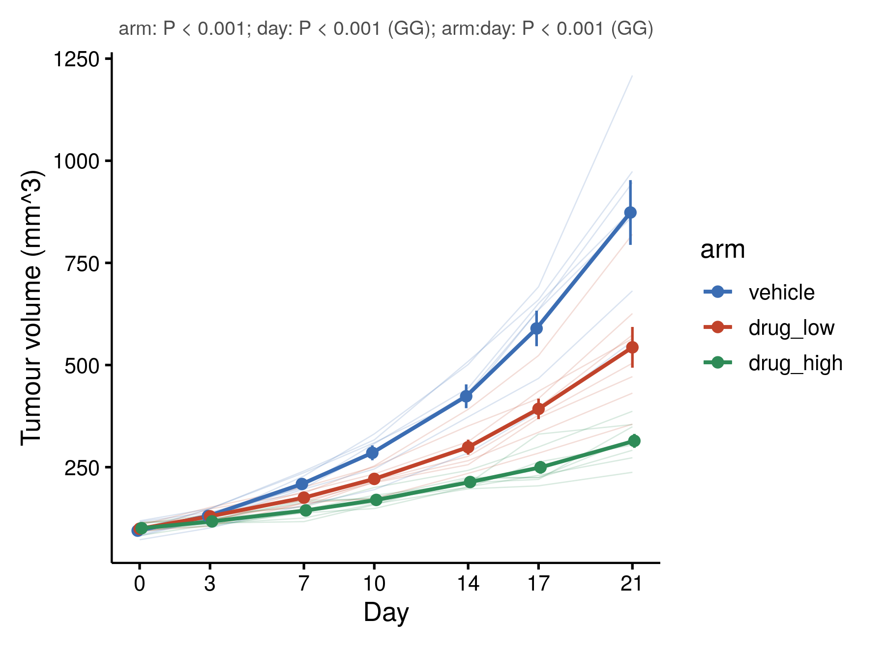

::: {.callout-important}
A manual command generated this report without an LLM model.
No separate human scientific review is part of this fixed recipe.
The report records the selected recipe and does not claim a new method.
:::

## Figure

## Statistical results

| effect | ss | df1 | df2 | F | p_value | gg_epsilon | p_gg | correction | p_reported | partial_eta2 |
| --- | --- | --- | --- | --- | --- | --- | --- | --- | --- | --- |
| arm | 897610.242605368 | 2 | 20 | 28.4305574531025 | 1.42309259382063e-06 |  |  | none | 1.42309259382063e-06 | 0.739790399548506 |
| day | 3844692.8373913 | 6 | 120 | 236.199202991279 | 5.68109139700991e-64 | 0.195129099189663 | 2.60714830706083e-14 | Greenhouse-Geisser | 2.60714830706083e-14 | 0.921935744660842 |
| arm:day | 938415.511843391 | 12 | 120 | 28.825839325367 | 8.61943233377385e-30 | 0.195129099189663 | 2.00397336096481e-07 | Greenhouse-Geisser | 2.00397336096481e-07 | 0.74243956669685 |

## Methods

Tumour volume (mm^3) was analysed with a mixed ANOVA with the group as a between-subjects factor and time as a within-subjects factor (n = 23 subjects, 7 time points). 1 subject(s) without a value at every time point were excluded. Sphericity was assessed with Mauchly's test (W = 0.000, P = 2.1e-37); because it was rejected, the within-subject effects carry the Greenhouse-Geisser correction (epsilon = 0.195). arm, F(2, 20) = 28.43, P < 0.001, partial eta squared = 0.740; day, F(1.17, 23.42) = 236.20, P < 0.001, partial eta squared = 0.922; arm:day, F(2.34, 23.42) = 28.83, P < 0.001, partial eta squared = 0.742. The figure shows the mean +/- SEM at each time point, with one thin line per subject. Computed in R 4.4.1 and drawn with ggplot2 3.5.1.

## Plot configuration

The complete plot configuration is in `plot_config.yaml`.

## Provenance

| field | value |
| --- | --- |
| repository | pubready |
| repository_version | 2.0.0 |
| git_commit | 1b8bb2fd31d9315d60137be3bc664c2a3e33f671 |
| git_dirty | FALSE |
| llm_provider | none |
| llm_model | none |
| agent_harness | manual |
| agent_harness_version | not_recorded |
| container_image | localhost/pubready:2.0.0 |
| container_digest | sha256:f22d119d4121702c30e3632421cdf83f9bc1b190c13c3547876874aed2f0419e |
| input | {"file":"input_volume_mm3.csv","md5":"b86e88025259e6532a144d1496106495","sha256":"dbf732b2b6cf9b41409b5419f1f5a21faabab658b627b18f9ac51654c2f09614"} |
| command | figkit plot --recipe timecourse |
| analysis_options | {"engine":"r","recipe":"timecourse","data":{"file":"tumor_growth.csv","x":"day","y":"volume_mm3","fill":null,"facet":null,"time":null,"event":null,"annotation":null,"id":"mouse","group":"arm","label":null,"positive":null,"se":null,"ci_low":null,"ci_high":null,"measure":null,"ref":null,"cause":null,"levels":null,"markers":null,"covariates":null},"test":{"method":"auto","paired":false,"p_adjust":"none"},"appearance":{"theme":"pubready_house","palette":null,"x_label":"Day","y_label":"Tumour volume (mm^3)","title":null,"y_limits":[null,null],"show_points":true,"geom":"box","bracket":{"show":true,"label":"p.signif"},"scale":"row","cluster":"both","fc_cutoff":1,"p_cutoff":0.05,"top_n":15,"pd_threshold":20,"pr_threshold":-30}} |
| random_seeds | not_applicable |
| session_record | session_info.txt |
| created_utc | 2026-07-18T00:00:00Z |
| review_state | not_applicable |
| reviewer | none |
| quarto_version | 1.11.4 |

The report source reads only files in this bundle.
