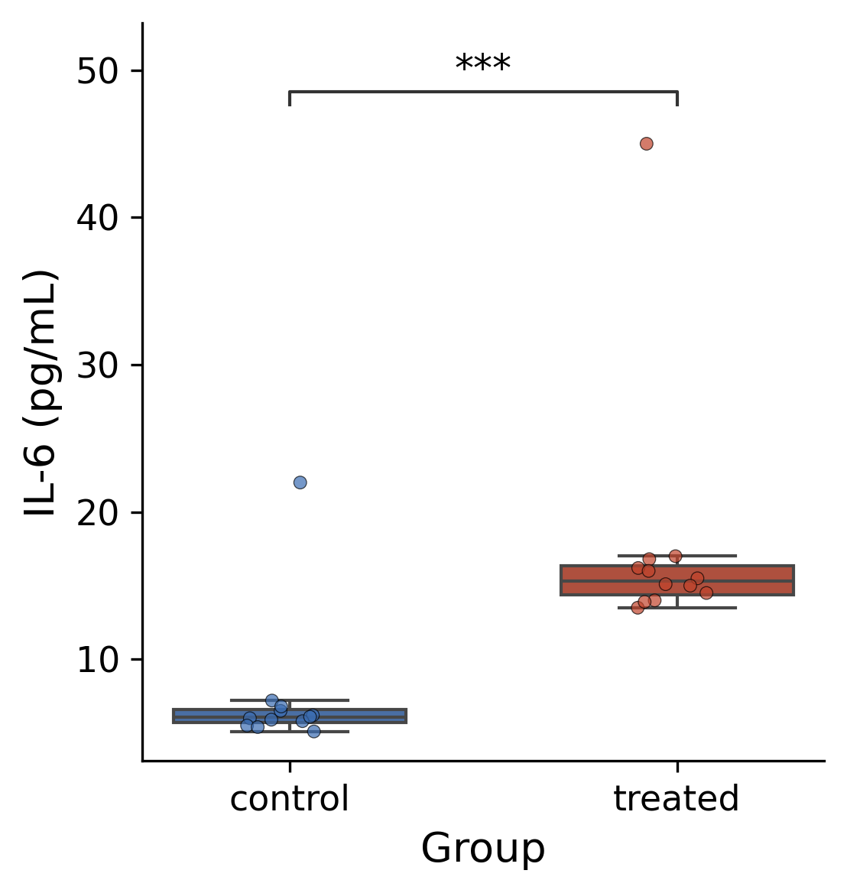

::: {.callout-important}
A manual command generated this report without an LLM model.
No separate human scientific review is part of this fixed recipe.
The report records the selected recipe and does not claim a new statistical method.
:::

## Figure

## Statistical results

| outcome | group1 | group2 | n1 | n2 | test | statistic | df | p_value | p_adjust_method | effect_size_name | effect_size | shapiro_p_group1 | shapiro_p_group2 | var_equal_p |
| --- | --- | --- | --- | --- | --- | --- | --- | --- | --- | --- | --- | --- | --- | --- |
| concentration | control | treated | 12 | 12 | Mann-Whitney U test | 11.0 | nan | 0.00014422244870488242 | none | rank-biserial r | -0.8472222222222222 | 7.385806425474998e-06 | 7.854417264035744e-06 | 0.5591467798686465 |

## Methods

IL-6 (pg/mL) was compared between the two groups with a Mann-Whitney U test. Normality was assessed with the Shapiro-Wilk test. A non-parametric test was used because the normality assumption was not met. Effect size is reported as rank-biserial r = -0.85. Significance was set at P < 0.05. Analyses were performed in Python 3.10.12 with pingouin 0.6.1; figures were produced with seaborn 0.13.2 and statannotations 0.7.2. Group sizes were n = 12 and n = 12.

## Plot configuration

The complete plot configuration is in `plot_config.yaml`.

## Provenance

| field | value |
| --- | --- |
| repository | pubready |
| repository_version | 1.0.0 |
| git_commit | f66e11ade8775d5c33ce81c38926927708b194cb |
| git_dirty | True |
| llm_provider | none |
| llm_model | none |
| agent_harness | manual |
| agent_harness_version | not_recorded |
| container_image | localhost/pubready:1.0.0 |
| container_digest | sha256:4aad0f46de6f65d943f66f6dd38001a64036986b3ec44c955a52a594a496fb6e |
| input | {"file": "input_concentration.csv", "md5": "71253c2a457715e5eb78ba8b5da99b7b", "sha256": "b4591b64add603dd5d4d265e4d7ddb417b65359ca5c76a169152e8d01041413c"} |
| command | figkit plot --recipe two_group_compare |
| analysis_options | {"engine": "python", "recipe": "two_group_compare", "data": {"file": "cytokine_pg_ml.csv", "x": "group", "y": "concentration", "fill": null, "facet": null, "time": null, "event": null, "annotation": null, "covariates": null, "id": null, "group": null, "label": null, "positive": null, "se": null, "ci_low": null, "ci_high": null, "measure": null, "markers": null}, "test": {"method": "auto", "paired": false, "p_adjust": "none"}, "appearance": {"theme": "pubready_house", "palette": null, "x_label": "Group", "y_label": "IL-6 (pg/mL)", "title": null, "y_limits": [null, null], "show_points": true, "geom": "box", "bracket": {"show": true, "label": "p.signif"}, "scale": "row", "cluster": "both", "fc_cutoff": 1.0, "p_cutoff": 0.05, "top_n": 15, "pd_threshold": 20.0, "pr_threshold": -30.0}} |
| random_seeds | not_applicable |
| session_record | session_info.txt |
| created_utc | 2026-07-18T00:00:00Z |
| review_state | not_applicable |
| reviewer | none |
| quarto_version | 1.11.4 |

The report source reads only files in this bundle.
