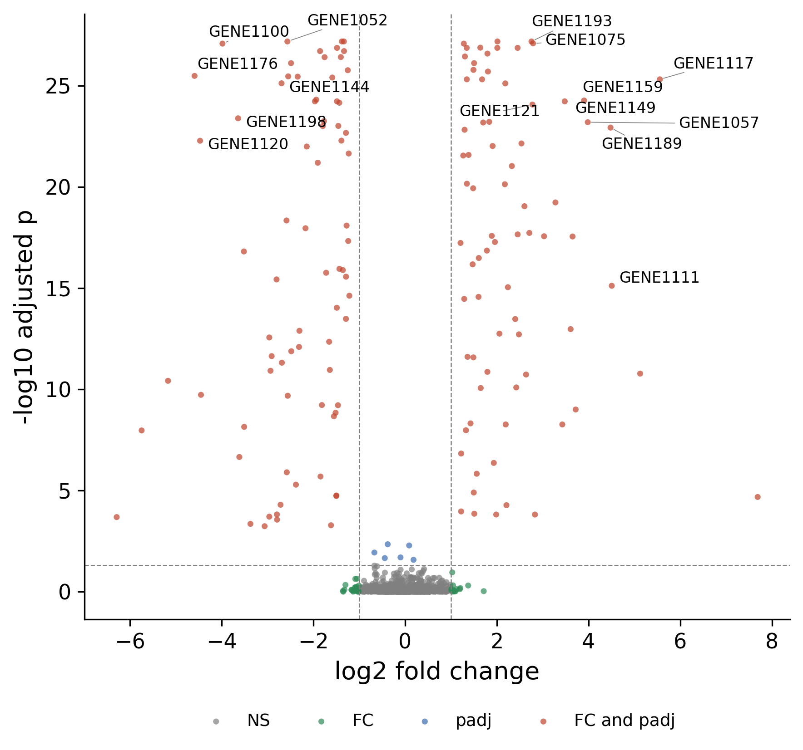

::: {.callout-important}
A manual command generated this report without an LLM model.
No separate human scientific review is part of this fixed recipe.
The report records the selected recipe and does not claim a new statistical method.
:::

## Figure

## Statistical results

| gene | log2FC | p_value | neg_log10_p | direction |
| --- | --- | --- | --- | --- |
| GENE1117 | 5.5536 | 4.9140000000000006e-26 | 25.308564847855937 | up |
| GENE1176 | -4.5902 | 3.3140000000000005e-26 | 25.479647495916684 | down |
| GENE1100 | -3.9807 | 8.438e-28 | 27.07376047895414 | down |
| GENE1189 | 4.4787 | 1.19e-23 | 22.92445303860747 | up |
| GENE1120 | -4.4697 | 5.291e-23 | 22.276462238467943 | down |
| GENE1159 | 3.9022 | 5.459e-25 | 24.26288690569404 | up |
| GENE1057 | 3.9823 | 6.436e-24 | 23.19138396457301 | up |
| GENE1198 | -3.6406 | 4.124e-24 | 23.38468134338852 | down |
| GENE1149 | 3.4802 | 6.001e-25 | 24.221776373233904 | up |
| GENE1075 | 2.7896 | 8.213e-28 | 27.085498177172685 | up |
| GENE1193 | 2.7555 | 6.6110000000000005e-28 | 27.179732842839037 | up |
| GENE1052 | -2.5663 | 6.6110000000000005e-28 | 27.179732842839037 | down |
| GENE1111 | 4.5058 | 7.712e-16 | 15.112832979105226 | up |
| GENE1144 | -2.6933 | 7.698e-26 | 25.11362209324143 | down |
| GENE1121 | 2.776 | 8.604e-25 | 24.065299598284575 | up |

## Methods

Differential-expression results for 1200 features were shown as a volcano plot. Features with |log2 fold change| >= 1 and padj <= 0.05 were called significant; 75 were up-regulated and 75 down-regulated. The 15 significant features with the largest product of |log2 fold change| and -log10 padj are labelled. The differential test itself was performed upstream; this figure summarises its output. Drawn in Python 3.10.12 with matplotlib 3.10.9 and adjustText 1.4.0.

## Plot configuration

The complete plot configuration is in `plot_config.yaml`.

## Provenance

| field | value |
| --- | --- |
| repository | pubready |
| repository_version | 2.0.0 |
| git_commit | a9f218358c74881d725e4bdcd4c40be832ba06c8 |
| git_dirty | False |
| llm_provider | none |
| llm_model | none |
| agent_harness | manual |
| agent_harness_version | not_recorded |
| container_image | localhost/pubready:2.0.0 |
| container_digest | sha256:f22d119d4121702c30e3632421cdf83f9bc1b190c13c3547876874aed2f0419e |
| input | {"file": "input_de_results.csv", "md5": "cccbb84090f24cd1610407c75dcadee2", "sha256": "487ba326154d5adb67175907eefabc4055bc7a610511a1175ca4cf5ac70248ae"} |
| command | figkit plot --recipe volcano |
| analysis_options | {"engine": "python", "recipe": "volcano", "data": {"file": "de_results.csv", "x": null, "y": "padj", "fill": null, "facet": null, "time": null, "event": null, "annotation": null, "covariates": null, "id": null, "group": null, "label": null, "positive": null, "se": null, "ci_low": null, "ci_high": null, "measure": null, "ref": null, "cause": null, "levels": null, "markers": null}, "test": {"method": "auto", "paired": false, "p_adjust": "none"}, "appearance": {"theme": "pubready_house", "palette": null, "x_label": null, "y_label": "-log10 adjusted p", "title": null, "y_limits": [null, null], "show_points": true, "geom": "box", "bracket": {"show": true, "label": "p.signif"}, "scale": "row", "cluster": "both", "fc_cutoff": 1.0, "p_cutoff": 0.05, "top_n": 15, "pd_threshold": 20.0, "pr_threshold": -30.0}} |
| random_seeds | not_applicable |
| session_record | session_info.txt |
| created_utc | 2026-07-18T00:00:00Z |
| review_state | not_applicable |
| reviewer | none |
| quarto_version | 1.11.4 |

The report source reads only files in this bundle.
