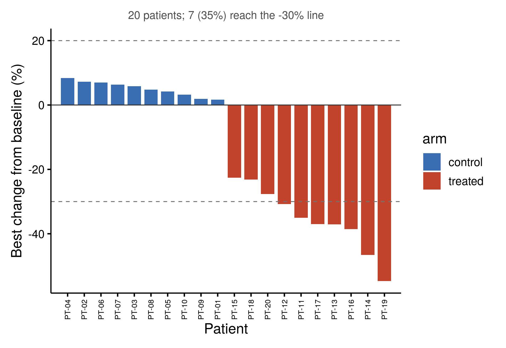

::: {.callout-important}
A manual command generated this report without an LLM model.
No separate human scientific review is part of this fixed recipe.
The report records the selected recipe and does not claim a new method.
:::

## Figure

## Statistical results

| patient | group | best_change_pct | worst_change_pct | category_from_change |
| --- | --- | --- | --- | --- |
| PT-04 | control | 8.35380835380835 | 26.044226044226 | progressive disease |
| PT-02 | control | 7.25 | 31 | progressive disease |
| PT-06 | control | 6.95553021664766 | 27.2519954389966 | progressive disease |
| PT-07 | control | 6.32054176072236 | 26.410835214447 | progressive disease |
| PT-03 | control | 5.80152671755725 | 13.587786259542 | stable disease |
| PT-08 | control | 4.77064220183486 | 11.1926605504587 | stable disease |
| PT-05 | control | 4.16666666666666 | 10.8796296296296 | stable disease |
| PT-10 | control | 3.24675324675325 | 24.4588744588745 | progressive disease |
| PT-09 | control | 1.9047619047619 | 16.6666666666667 | stable disease |
| PT-01 | control | 1.66975881261595 | 15.5844155844156 | stable disease |
| PT-15 | treated | -22.5554106910039 | -15.1238591916558 | stable disease |
| PT-18 | treated | -23.1858407079646 | -1.76991150442478 | stable disease |
| PT-20 | treated | -27.65625 | -1.25 | stable disease |
| PT-12 | treated | -30.8064516129032 | -8.87096774193548 | partial response |
| PT-11 | treated | -35.0409836065574 | -7.17213114754098 | partial response |
| PT-17 | treated | -36.9734789391576 | -8.58034321372854 | partial response |
| PT-13 | treated | -37.1194379391101 | -8.8992974238876 | partial response |
| PT-16 | treated | -38.5735080058224 | -10.6259097525473 | partial response |
| PT-14 | treated | -46.6101694915254 | -9.68523002421307 | partial response |
| PT-19 | treated | -54.6972860125261 | -15.4488517745303 | partial response |

## Methods

The best response of each patient was the smallest percentage change in target_lesion_mm from that patient's own baseline over the visits after it. The 20 patients are drawn as bars sorted from the largest increase to the deepest decrease, with dashed reference lines at +20% and -30%, the RECIST 1.1 thresholds for progressive disease and for a partial response. On the change from baseline alone, 7 patient(s) reached a partial response, 8 were stable and 5 reached progressive disease. A full RECIST 1.1 assessment also reads the non-target lesions and any new lesion. The figure is descriptive, so no statistical test is applied. Drawn in R 4.4.1 with ggplot2 3.5.1.

## Plot configuration

The complete plot configuration is in `plot_config.yaml`.

## Provenance

| field | value |
| --- | --- |
| repository | pubready |
| repository_version | 4.0.0 |
| git_commit | 567ce8900bdb5db88369d131c8d787b042b3af57 |
| git_dirty | FALSE |
| llm_provider | none |
| llm_model | none |
| agent_harness | manual |
| agent_harness_version | not_recorded |
| container_image | localhost/pubready:4.0.0 |
| container_digest | sha256:0f57027a3fbca5ec9d41d74ca91226fbdf45d94b1a85f271637d12733db5d483 |
| input | {"file":"input_target_lesion_mm.csv","md5":"d3ceaf1a40e01ce2639a76cda972d28e","sha256":"97ca47b3a60d61efa8b26f77be4c7169722126bb8198f60c17acef4d6f04d23c"} |
| command | figkit plot --recipe waterfall |
| analysis_options | {"engine":"r","recipe":"waterfall","data":{"file":"spider_response.csv","x":"week","y":"target_lesion_mm","fill":null,"facet":null,"time":null,"event":null,"annotation":null,"id":"patient","group":"arm","label":null,"positive":null,"se":null,"ci_low":null,"ci_high":null,"measure":null,"ref":null,"cause":null,"levels":null,"visit_levels":null,"features":null,"markers":null,"covariates":null},"test":{"method":"auto","paired":false},"appearance":{"theme":"pubready_house","palette":null,"x_label":null,"y_label":null,"title":null,"y_limits":[null,null],"show_points":true,"geom":"box","bracket":{"show":true,"label":"p.signif"},"scale":"row","cluster":"both","fc_cutoff":1,"p_cutoff":0.05,"top_n":15,"pd_threshold":20,"pr_threshold":-30}} |
| random_seeds | not_applicable |
| session_record | session_info.txt |
| created_utc | 2026-07-18T00:00:00Z |
| review_state | not_applicable |
| reviewer | none |
| quarto_version | 1.11.4 |

The report source reads only files in this bundle.
